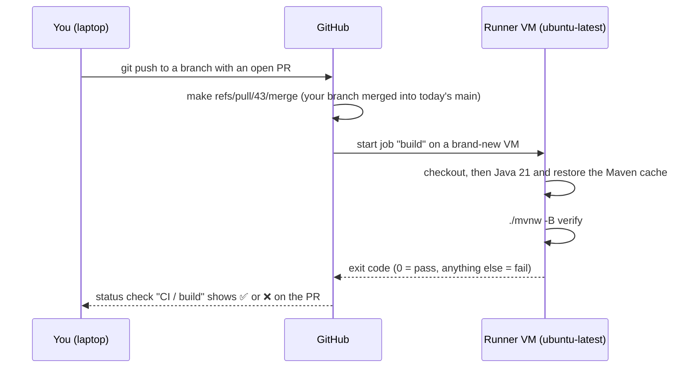
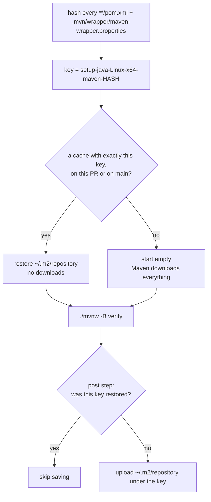

## Part 1 — The Concept

### The story

Today `./mvnw verify` is green **on your laptop**, and nothing stops a pull request from
reaching `main` with a red test, a missing file, or a build that only works on Windows.
From TKT-103 on, every ticket adds tests against real Postgres, Redis and Kafka, and
those are exactly the tests people skip locally ("Docker wasn't running").

CI closes that gap. A **fresh Linux machine** on GitHub checks out the PR, runs the same
`./mvnw -B verify`, and puts a ✅ or ❌ on the PR. Then `main` is told to refuse anything
without the ✅.

This is **not TDD** (learning record 0001). TDD drives *your code*: a test goes red, then
your code makes it green. CI is a safety net for the *pipeline*. You prove the net works
once, on this ticket's own PR, by breaking a test **on purpose** and watching the check
go red.

**Done looks like:**
- [ ] Opening or updating a PR runs `./mvnw -B verify` on Java 21 (Temurin), and the result shows on the PR.
- [ ] A failing test turns that check red. You see it once on this PR, then green after the fix.
- [ ] Maven dependencies are cached between runs.
- [ ] `main` requires the check before a merge, or the PR records why it doesn't (Slice 4).

### The big picture

What happens between your `git push` and the ✅ on the PR:



### Ways to build it

| Option | How it works | When it wins |
|---|---|---|
| **GitHub Actions, one workflow, one job** | a YAML file in `.github/workflows/`; GitHub runs it on its own VMs, free at this repo's size | the code is on GitHub and one build covers everything |
| A job per service | a matrix, or one job per module | many services with long builds, where one red module shouldn't hide another |
| An outside CI (Jenkins, CircleCI…) | a server or SaaS watches the repo and reports back through the Checks API | the company already runs one, or needs special hardware |

### What we chose and why

**One workflow, one job, `./mvnw -B verify` at the root.** The root POM already builds
every module in order (TKT-101's reactor), so one command covers the whole backend. A job
per service only pays off once builds take minutes, and it would cost us the simple rule
"one check = the build is green".

- **The wrapper, not `mvn`.** The runner has its own Maven; your wrapper pins Maven
  3.10.0. The wrapper makes CI build with exactly what you build with.
- **Java set explicitly.** `ubuntu-latest` ships Java 8, 11, 17, 21 and 25, and its
  **default is 17**. Boot 4.1 with `java.version` 21 would not compile on it.
- **Backend only.** The acceptance criteria are about the Maven build. A second job for
  the frontend's `npm test` can come later.

### Under the hood

#### Workflow → job → steps, and what triggers them

```text
.github/workflows/ci.yml          ← one WORKFLOW (one file)
└── on: pull_request, push        ← the EVENTS that start it
    └── jobs:
        └── build                 ← one JOB = one fresh VM, nothing carried over
            ├── step: checkout    ← uses: a published action
            ├── step: setup-java  ← uses: a published action
            └── step: ./mvnw …    ← run: a shell command
```

- **There is no switch to turn on.** GitHub Actions is already on for this repo
  (Settings → Actions → General: *Allow all actions*). On every push or PR event, GitHub
  looks in `.github/workflows/` of the commit it is about to build and runs every
  workflow whose `on:` matches. **Committing the YAML file is how you set it up.** For a
  PR it reads the merge commit, so a workflow added *in* the PR runs on that same PR.
  A private repo on a free account gets 2,000 runner minutes a month.
- **`pull_request`** fires when a PR is `opened`, `synchronize`d (a new push to its
  branch) or `reopened`. It does **not** build your branch tip. It builds the **merge
  commit**, so green means "green *after* merging":

```text
main                 A ─── B ──────────── C          (C = today's main)
                            \               \
feature/TKT-102              D ─── E          \
                                    \           \
refs/pull/43/merge                   └────────── M   ← the commit CI checks out
```

- **`push`** builds the pushed commit itself. Limit it to `branches: [main]`, or every
  push to a branch with an open PR runs the build **twice**, once per event.
- **`permissions: contents: read`** — least privilege. The job only reads code; the
  default token can do more.
- **Source:** [GitHub Docs — Events that trigger workflows](https://docs.github.com/en/actions/reference/workflows-and-actions/events-that-trigger-workflows) (sections *pull_request* and *push*)

#### Setting up Java and caching Maven

`actions/setup-java@v6` with `distribution: temurin`, `java-version: '21'` installs the
JDK and puts it first on the `PATH`. With `cache: maven` it also caches
`~/.m2/repository`, plus the wrapper's downloaded Maven (`~/.m2/wrapper/dists`) as a
second cache called `maven-wrapper`. How one run decides what to do:



- **Same POMs → same key → hit.** Change a POM (a new starter in TKT-103) and the hash
  changes: that one run misses, downloads everything, and saves a new cache at the end.
- **`-B` (batch mode):** no prompts and no animated download progress, so the log stays
  readable. Always use it in CI.
- **Source:** [actions/setup-java — README](https://github.com/actions/setup-java) (sections *Caching packages dependencies* and *Maven*)

#### The runner is not your laptop

| | Your laptop (Windows) | The runner (Ubuntu 24.04) |
|---|---|---|
| Running `./mvnw` | works, Windows has no "executable" bit | only if git **stored** the file as executable (mode `100755`) |
| `Inventory.java` vs `inventory.java` | the same file | two different files |
| Docker | only if Docker Desktop is running | always there, so TKT-103's Testcontainers tests just run |
| Size | yours | private repo: 2 CPUs, 8 GB (public: 4 CPUs, 16 GB) |
| State | everything you ever downloaded | empty, every run, except what the cache restores |

- **Source:** [GitHub Docs — GitHub-hosted runners](https://docs.github.com/en/actions/reference/runners/github-hosted-runners) and the [Ubuntu 24.04 image README](https://github.com/actions/runner-images/blob/main/images/ubuntu/Ubuntu2404-Readme.md)

#### Status checks and protecting `main`

- Every job reports a **status check** on the commit, named after the job. On the PR it
  shows as `CI / build (pull_request)`: workflow name / job id (event).
- A check on its own is advice: you can still press *Merge* on a red PR. A **ruleset**
  (or classic branch protection) with *Require status checks to pass* turns it into a
  rule, and the merge button stays locked until the named check is green.
- **You pick the check by name**, and GitHub only offers names it has already seen, so
  the workflow must run once before you can require it. Rename the job later and the
  rule waits for a check that never comes.
- **This repo's catch:** it is **private on a free account**, and GitHub refuses
  protection there: *"Upgrade to GitHub Pro or make this repository public to enable
  this feature."* (tried 2026-11-17). That is the decision in Slice 4.
- **Source:** [GitHub Docs — About protected branches](https://docs.github.com/en/repositories/configuring-branches-and-merges-in-your-repository/managing-protected-branches/about-protected-branches) (section *Require status checks before merging*)

---

## Part 2 — The Implementation

**The seam** is the check row on the PR, not your terminal. Every slice is judged by what
GitHub shows there.
- **It catches** anything `./mvnw -B verify` catches, on a clean Linux machine, after a
  merge with today's `main`.
- **It misses** whatever `verify` doesn't run: the frontend, and `*IT` classes until
  Failsafe arrives in TKT-103.

How the check should move, commit by commit, over the whole ticket:

```text
commit                                                  check on the PR
──────────────────────────────────────────────────────  ───────────────
docs(docs): switch lessons to the two-part format       (none)
docs(infra): add the TKT-102 lesson                     (none)          ← before: nothing checks the PR
fix(infra): make the Maven wrapper executable           (none)
chore(infra): run the Maven build on every pull request ✅ build        ← Slice 1 green
test(inventory): break the health check on purpose      ❌ build        ← Slice 2 red
test(inventory): restore the health check expectation   ✅ build        ← Slice 2 green
```

### Before you start

You are on `main`, up to date with the F406 merge. Several files are changed but not
committed yet; they come with you to the new branch.

```bash
git status --short
```

> ✅ **Expected**
> ```text
>  M .claude/skills/skills-lock.json
>  M CLAUDE.md
>  M docs/learning/build.mjs
>  M docs/learning/template.html
>  M docs/process/HOW-WE-WORK.md
>  M docs/process/sprints/SPRINT-01.md
> ?? .claude/skills/ui-ux-pro-max/
> ?? docs/learning/lessons/TKT-102.md
> ```

> ⚠️ **Warning — never `git add .` on this ticket.** The `.claude/skills/` changes are
> yours and unrelated. Add files by name, as every commit below does.

### Slice 1 — a check appears on the PR

#### Step 1 — Create the branch

```bash
git switch main
git pull
git switch -c feature/TKT-102-ci-pipeline
```

> ✅ **Expected:** `Switched to a new branch 'feature/TKT-102-ci-pipeline'`. Your
> uncommitted changes are still there (`git status --short` shows the same list).

#### Step 2 — Commit the docs (two commits)

The new lesson format is its own change, so it gets its own commit. `CLAUDE.md` goes in
it too: it holds both the new rules and the TKT-102 status line.

```bash
git add CLAUDE.md docs/process/HOW-WE-WORK.md docs/learning/build.mjs docs/learning/template.html
git commit -m "docs(docs): switch lessons to the two-part format"
```

```bash
git add docs/learning/lessons/TKT-102.md docs/process/sprints/SPRINT-01.md
git commit -m "docs(infra): add the TKT-102 lesson"
```

> ✅ **Expected:** `git status --short` now shows only the `.claude/skills/` lines.

#### Step 3 — Push and open a draft PR (the "before" picture)

Why open a PR when the ticket isn't finished:
- **The PR is where CI shows up.** The workflow you write in Step 5 runs on
  `pull_request` events, and its ✅/❌ appears in the PR's checks box. Opening the PR now
  means every later push shows a run, so you see each slice land.
- **Draft means "not ready".** GitHub won't let a draft PR be merged and doesn't ask
  anyone to review it. You switch it to ready in Step 10.
- **`Closes #43` closes nothing yet.** It's a link: GitHub closes issue #43 only when
  this PR is **merged** into `main`. Until then the issue stays open and shows the PR
  under *Development*.

`gh` is the GitHub CLI. If you'd rather click, push with the first line, then use the
**Compare & pull request** banner on GitHub and pick **Create draft pull request**.

```bash
git push -u origin feature/TKT-102-ci-pipeline
gh pr create --draft --title "TKT-102: CI on every pull request" --body "Closes #43"
```

Open the PR in the browser and scroll to the checks box at the bottom.

> ✅ **Expected:** no `CI / build` row. You may see GitGuardian or CodeRabbit; they
> are other apps and don't build your code. Nothing red appears here: GitHub has nothing
> to report yet. That empty box is the "before" picture. The behaviour this ticket
> wants ("every PR gets a build check") is missing, which is what *red* means in TDD
> terms. The first real ❌ from GitHub comes in Step 6.

> ⚠️ **Warning — read this before writing the workflow.** Git on Windows stored `mvnw`
> as a plain file, not an executable. On Linux, `./mvnw` then dies before Maven starts:
> ```text
> /home/runner/work/_temp/3f1c….sh: line 1: ./mvnw: Permission denied
> Error: Process completed with exit code 126.
> ```
> That is a red for the wrong reason (learning record 0003). Step 4 fixes it first.

#### Step 4 — Make the wrapper executable in git

Look at the mode git stored:

```bash
git ls-files -s mvnw
```

```text
100644 bd8896bf2217b46faa0291585e01ac1a3441a958 0	mvnw
```

`100644` is a plain file and `100755` an executable one. Windows can't set the bit on
disk, so tell git directly:

```bash
git update-index --chmod=+x mvnw
git ls-files -s mvnw
```

> ✅ **Expected:** the mode changed and the **blob hash did not**, because only the mode
> changed, not the content:
> ```text
> 100755 bd8896bf2217b46faa0291585e01ac1a3441a958 0	mvnw
> ```

The change is already staged (`update-index` writes to the index), so commit it straight
away. Leave `mvnw.cmd` alone: Windows doesn't need the bit.

```bash
git commit -m "fix(infra): make the Maven wrapper executable"
```

#### Step 5 — Write the workflow (🟢 green)

```text
ticketing-platform/
├── .github/
│   ├── ISSUE_TEMPLATE/
│   ├── pull_request_template.md
│   └── workflows/                 ← new folder
│       └── ci.yml                 ← new file
├── .mvn/wrapper/maven-wrapper.properties
├── mvnw                           ← now 100755
├── pom.xml
└── services/inventory/
```

This is the step where GitHub Actions comes in. There is nothing to click on GitHub:
the file below, pushed to your branch, is the whole setup. Create
`.github/workflows/ci.yml` and type this in:

```yaml
name: CI

on:
  pull_request:
  push:
    branches: [main]

permissions:
  contents: read

jobs:
  build:
    runs-on: ubuntu-latest
    steps:
      - name: Check out
        uses: actions/checkout@v7

      - name: Set up JDK 21
        uses: actions/setup-java@v6
        with:
          distribution: temurin
          java-version: '21'
          cache: maven

      - name: Build and test
        run: ./mvnw -B verify
```

| Line | Why it is there |
|---|---|
| `name: CI` | the first half of the check's name, `CI / build` |
| `pull_request:` with nothing under it | the default types: opened, synchronize, reopened |
| `push: branches: [main]` | builds `main` after each merge (and gives `main` a cache every branch can use), without double runs on feature branches |
| `permissions: contents: read` | the token can read the code and nothing else |
| `build:` | the job id, the second half of the check's name. Slice 4 requires it **by this name** |
| `java-version: '21'` in quotes | YAML reads a bare `21` as a number; quoting keeps versions like `'21.0'` from turning into `21` |
| `cache: maven` | the cache from Part 1; the key is computed for you |
| `./mvnw -B verify` | the same command as on your laptop, in batch mode |

> ⚠️ **Warning — indentation is the syntax.** Two spaces per level, never tabs. A step
> starts with `- ` and its keys (`uses:`, `with:`) line up under the `n` of `name`. A
> mistake here doesn't show as a red build: GitHub rejects the file and shows *Invalid
> workflow file* in the **Actions** tab, with no check on the PR.

Commit and push:

```bash
git add .github/workflows/ci.yml
git commit -m "chore(infra): run the Maven build on every pull request"
git push
```

> ✅ **Expected on the PR:** a row `CI / build (pull_request)`, first yellow (running),
> then green. Open **Details** → the **Build and test** step; the end of the log reads
> (your times will differ):
> ```text
> [INFO] Tests run: 2, Failures: 0, Errors: 0, Skipped: 0
> ...
> [INFO] Reactor Summary for ticketing-platform 0.1.0-SNAPSHOT:
> [INFO]
> [INFO] ticketing-platform ................................. SUCCESS [  0.3 s]
> [INFO] inventory .......................................... SUCCESS [ 31.2 s]
> [INFO] ------------------------------------------------------------------------
> [INFO] BUILD SUCCESS
> ```

**Slice 1 is done.** Paste me the check row and the last lines of the log.

### Slice 2 — a failing test turns the check red

#### Step 6 — Break a test on purpose (🔴 red)

In `services/inventory/src/test/java/com/stadium/inventory/HealthEndpointTest.java`,
change the expected status:

```java
                .jsonPath("$.status").isEqualTo("DOWN");   // was "UP": broken on purpose for TKT-102
```

Run it locally first, so you know what the failure looks like:

```bash
./mvnw -pl services/inventory test
```

> ✅ **Expected (a real assertion failure, not a setup error):**
> ```text
> [ERROR] Failures:
> [ERROR]   HealthEndpointTest.healthEndpointReportsUp:22 JSON path "$.status" expected:<DOWN> but was:<UP>
> [ERROR] Tests run: 2, Failures: 1, Errors: 0, Skipped: 0
> ...
> [INFO] BUILD FAILURE
> ```

The commit message says the break is deliberate, so nobody "fixes" it by mistake:

```bash
git add services/inventory/src/test/java/com/stadium/inventory/HealthEndpointTest.java
git commit -m "test(inventory): break the health check on purpose to prove CI goes red"
git push
```

> ✅ **Expected on the PR:** `CI / build (pull_request)` turns red. In **Details**, the
> **Build and test** step shows the **same** `expected:<DOWN> but was:<UP>` line you saw
> locally. If the red comes from any other step, it's a red for the wrong reason: stop
> and tell me.

#### Step 7 — Undo it with a revert commit (🟢 green)

Don't edit history: the PR keeps the proof that CI caught the break. `git revert` makes
a **new** commit that undoes an old one. `--no-commit` lets you write the message in our
format:

```bash
git revert --no-commit HEAD
git commit -m "test(inventory): restore the health check expectation"
git push
```

> ✅ **Expected:** the file says `"UP"` again, and the check goes back to green.
> `git log --oneline -3` shows both commits, the break and the restore, on top of the
> workflow commit.

### Slice 3 — the cache works

Nothing to commit here, unless something is wrong. This slice is an observation.

> ⚠️ **Warning — a cache belongs to a branch.** A cache saved by this PR's first run
> lives on `refs/pull/43/merge`. Later runs **of this PR** can restore it; another PR
> can't. Only after the merge, when the `push` run on `main` saves a cache, does every
> branch share one. So the first run of every new PR will miss until `main` has a cache.

#### Step 8 — Compare the first run with a later one

Open the **Actions** tab, then the run from Step 5 (the first one). Expand **Set up JDK 21**:

> ✅ **Expected (first run: miss):**
> ```text
> maven cache is not found
> maven-wrapper cache is not found
> ```
> and at the very end of the job, in **Post Set up JDK 21**:
> ```text
> Cache saved with the key: setup-java-Linux-x64-maven-<hash>
> ```

Now open the run from Step 7:

> ✅ **Expected (later run: hit):**
> ```text
> Cache restored from key: setup-java-Linux-x64-maven-<hash>
> maven-wrapper cache restored from key: setup-java-Linux-x64-maven-wrapper-<hash>
> ```
> and in **Post Set up JDK 21**:
> ```text
> Cache hit occurred on the primary key setup-java-Linux-x64-maven-<hash>, not saving cache.
> ```

Write down how long **Build and test** took in each run. Both numbers go into the PR
description, under *What changed*.

### Slice 4 — `main` refuses a red PR (your decision)

Choose one, and put the choice and your reason in the PR description:

| Option | What it costs | What you get |
|---|---|---|
| **Make the repo public** | anyone can read the code and its history (GitGuardian already scans for secrets) | free protection, bigger runners, a portfolio people can open |
| **Stay private, pay for Pro** | a monthly fee | protection and privacy |
| **Stay private, no enforcement** | nothing | CI still runs and shows ❌, but merging green stays a habit, not a rule. Record it as a known gap |

> ⚠️ **Warning:** the check name only shows up in the picker after the workflow has
> run, which Slice 1 already did. Pick `build`, the job id, not `CI`.

#### Step 9 — Protect `main` (only if you went public or Pro)

On GitHub: **Settings → Rules → Rulesets → New ruleset → New branch ruleset**.

| Field | Value |
|---|---|
| Ruleset name | `main` |
| Enforcement status | **Active** |
| Target branches | **Add target → Include default branch** |
| Require a pull request before merging | ✅ |
| Require status checks to pass | ✅ → **Add checks** → `build` |
| Block force pushes | ✅ (on by default) |

Press **Create**.

> ✅ **Expected:** on the PR, the checks box marks `build` as **Required**. On any PR with
> a red `build`, the merge box says merging is blocked.

### Finish the ticket

#### Step 10 — Fill in the PR and mark it ready

Edit the PR description into the template (`.github/pull_request_template.md`):
- *What changed:* the workflow, the wrapper's mode, and the two cache timings.
- *Acceptance criteria:* each one with the run that proves it.
- *Why this approach:* your Slice 4 choice and the reason.

```bash
gh pr ready
```

Then run `/code-review`, make any refactor commits, and tell me. I review the whole PR,
do the close step (wrap-up, notes, status) on this branch, and say when to merge.

#### If it goes wrong

| What you see | Where | What it means |
|---|---|---|
| `Permission denied`, exit code 126 | Build and test | Step 4 is missing or wasn't pushed: `git ls-files -s mvnw` still says `100644` |
| *Invalid workflow file* and no check on the PR | Actions tab | a YAML indentation or key error; the message names the line |
| `error: release version 21 not supported` | Build and test | Maven is running on the runner's Java 17: check the setup-java step and its `java-version` |
| Two runs for one push | the PR's checks | `push:` isn't limited to `branches: [main]` |
| `build` missing from the check picker | ruleset page | the workflow hasn't run yet on this repo, or the job id isn't `build` |

---

## Check yourself

```quiz
A pull_request run builds which commit by default?
- [ ] The newest commit on your feature branch
- [x] Your branch merged into the current main
- [ ] The commit main pointed to when you branched
> pull_request checks out refs/pull/N/merge, the merge of your branch into today's base branch, so green means "green after merging".
```

```quiz
Why does the workflow need actions/setup-java at all?
- [x] The runner's default Java is 17, not 21
- [ ] The runner has no Java installed at all
- [ ] Maven refuses JDKs it did not download
> ubuntu-latest has several JDKs but defaults to 17; Boot 4.1 with java.version 21 needs 21 on the PATH.
```

```quiz
You add a new starter to the inventory POM. What happens to the Maven cache?
- [ ] It is restored, then Maven ignores it
- [ ] Nothing, the key comes from the branch name
- [x] The key changes; this run downloads again
> The key is a hash of every pom.xml (and the wrapper properties), so a POM change means a cache miss, then a fresh save in the post step.
```

```quiz
After git update-index --chmod=+x mvnw, what changes in git ls-files -s?
- [ ] The blob hash, because the file is new
- [x] Only the mode, from 100644 to 100755
- [ ] Both the mode and the blob hash change
> The mode is stored in the tree, not in the blob; the content is the same bytes, so the hash stays.
```

```quiz
The check is green but you can still merge a red PR. What is missing?
- [ ] A second workflow that runs on merge
- [ ] The -B flag on the Maven command line
- [x] A rule on main that requires the check
> A status check only reports; a ruleset or branch protection that requires it is what locks the merge button.
```

---

_Ask me anything that's unclear — about the lesson, the docs, or what you see in your terminal._
