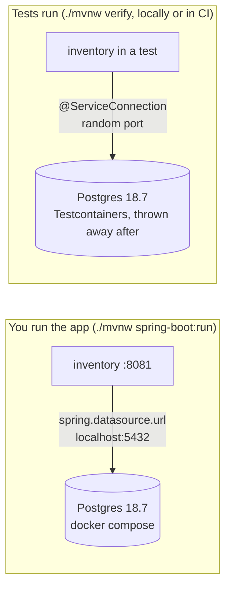

## Part 1 — The Concept

### The story

TKT-103 ([#46](https://github.com/anasha447/stadium-ticketing/issues/46)) gives
`inventory` a database. By the end of it, Postgres holds the stadium's **layout**:
120 Blocks per Match, not 60,560 Seat rows (ADR-0007). It also holds one Seat Claim per
real sale, and a partial unique index makes the database itself refuse to sell a Seat
twice. That is the backstop behind Redis (ADR-0001).

That's too much for one lesson, so the ticket is three, one per slice:

| Lesson | Slice | Proves |
|---|---|---|
| **TKT-103-1** (this one) | Postgres runs, and `inventory` connects to it | Compose starts a healthy Postgres; `/actuator/health` shows `db` `UP` |
| TKT-103-2 | Flyway creates the schema; the database refuses bad data | the three tables, the CHECKs, the overselling backstop. It also tells the 60,560-Seat story: what you store and why |
| TKT-103-3 | JPA maps the tables exactly | entities, `@EmbeddedId`, `EnumType.STRING`, `INT[]`, schema validation at startup |

Before any schema, this slice answers one question: **can the service reach a database,
and does it tell you honestly when it can't?** It has to work in **two places**: on your
laptop when you run the app, and in tests on any machine, including the CI runner from
TKT-102.

**Done looks like:**
- [ ] `docker compose up -d` starts a pinned Postgres that reports `healthy`, with an `inventory_db` database.
- [ ] A test proves `/actuator/health` shows a `db` component `UP`, against a real Postgres that the test starts itself.
- [ ] Run locally, `inventory` reports `db` `UP`. Stop Postgres and it reports `DOWN` with HTTP 503.
- [ ] CI is still green, now with a Postgres container on the runner.

### The big picture

One app, two ways to find its database:



- **Compose** is for you: a Postgres that stays up, on a fixed port, with its data kept in
  a volume.
- **Testcontainers** is for the tests: each run starts a fresh Postgres on a random port
  and removes it afterwards. No test depends on Compose running, so CI needs no Compose.
- **The same image tag in both** (`postgres:18.7-alpine3.23`), so what you see locally is
  what the tests see.

### Ways to build it

| Option | How it works | When it wins |
|---|---|---|
| **Compose for running + Testcontainers for tests** | two separate, explicit ways to get a Postgres | you want tests that run anywhere and a dev database you control |
| H2 in memory for tests | an embedded Java database, no Docker | never for us: H2 has no partial indexes, and its arrays and regex differ from Postgres. A green test there proves nothing about the backstop |
| Spring Boot "Docker Compose Support" | Boot starts `compose.yaml` itself when the app starts | quick local setups. It would hide the "Postgres is down" case this slice wants you to see |
| One shared Postgres for tests and dev | tests use the Compose database | never: tests would depend on your local state and fail in CI |

### What we chose and why

**Compose for running, Testcontainers for tests, both on `postgres:18.7-alpine3.23`.**
- Testcontainers tests the **real** database. Slices 2 and 3 depend on Postgres-only
  features: partial unique indexes, `INT[]`, regex CHECKs.
- Compose stays explicit: you start and stop it, so you can watch what `inventory` does
  when its database disappears.
- The tag is **pinned** to Postgres **and** Alpine (`18.7-alpine3.23`, not `latest` or
  `18.7-alpine`). `latest` changes under you on the next pull, and a new major version can
  change the data folder (Postgres 18 just did).
- **JDBC API, not JPA yet.** This slice needs a connection pool, nothing more. Slice 2
  tests the backstop with plain SQL, so the database is tested on its own terms. JPA
  arrives in slice 3 (rule 8: dependencies just in time).

### Under the hood

#### Compose: a pinned image, a healthcheck, a volume

- **A tag is a pointer, not a version.** On 18 Nov 2026 `postgres:18.7-alpine` moved from
  Alpine 3.23 to 3.24, so it now names a different image than `18.7-alpine3.23`, though
  both hold Postgres 18.7. Docker matches tags by name: having one doesn't satisfy the
  other, and Compose pulls. Only a digest (`postgres@sha256:…`) never moves.

```text
tag                →  image (digest)
18.7-alpine3.23    →  sha256:f3ee138d…  ← pinned here: stays on Alpine 3.23
18.7-alpine3.24    →  sha256:ff64c9e3…
18.7-alpine        →  sha256:ff64c9e3…  ← follows the newest Alpine; moved 18 Nov
```

- **`healthcheck`** runs a command inside the container on a timer. Postgres ships
  `pg_isready`, which exits 0 only when the server accepts connections. Compose shows the
  result as `(healthy)` in `docker compose ps`. "Up" alone only means the process
  started, which can be seconds before Postgres accepts connections.
- **A named volume** keeps the data when the container is removed. `docker compose down`
  keeps it; `docker compose down -v` deletes it.
- **Postgres 18 moved its data folder.** The image's `VOLUME` is now `/var/lib/postgresql`
  (data in `/var/lib/postgresql/18/docker`). Most tutorials mount `/var/lib/postgresql/data`,
  which is wrong for 18+.
- **`POSTGRES_DB`** creates the database on the **first** start only, when the volume is
  empty. Change it later and nothing happens until you delete the volume.
- **Source:** [Compose file reference — healthcheck](https://docs.docker.com/reference/compose-file/services/#healthcheck) and the [postgres image page](https://hub.docker.com/_/postgres) (PGDATA, *Environment Variables*)

#### DataSource auto-configuration and a lazy pool

What happens when the `JDBC API` starter and the PostgreSQL driver are on the classpath:

```text
startup
  ├─ DataSourceAutoConfiguration: "a JDBC driver is here → build a DataSource"
  │     needs a URL ── from ConnectionDetails (tests) or spring.datasource.url (you)
  │                └─ neither?  → context fails: "'url' attribute is not specified"
  └─ HikariDataSource created         pool: [ ]  0 connections, nothing dialled yet
                                       app reports "Started" even if Postgres is down
first getConnection()  (e.g. the health check)
  └─ Hikari dials Postgres  ── ok  →   pool: [c1 c2 …]   db UP
                            └─ fail →  exception          db DOWN
```

- **Lazy means it starts anyway.** With only JDBC, nothing asks for a connection at
  startup, so `inventory` starts with Postgres down. You'll see that in Step 7.
  Slice 2's Flyway asks for one at startup, and then a dead database stops the app.
- **Properties are the default; environment variables win.** `spring.datasource.password`
  in YAML can be overridden by `SPRING_DATASOURCE_PASSWORD` in the environment (relaxed
  binding). That's how Kubernetes will pass real secrets later.
- **Source:** [Spring Boot reference — SQL Databases, Configure a DataSource](https://docs.spring.io/spring-boot/reference/data/sql.html#data.sql.datasource)

#### Testcontainers and `@ServiceConnection`

```text
@Import(TestcontainersConfiguration.class)        ← the test pulls in the config
        │
        ▼
@Bean @ServiceConnection PostgreSQLContainer      ← Spring starts the container as a bean
        │   (random host port, random password)
        ▼
JdbcConnectionDetails bean ─────────────▶ DataSource uses THESE
spring.datasource.url in application.yaml ─╳   (ignored: details beat properties)
```

- The container is a **Spring bean**: it starts when the test's context starts and stops
  when the context closes.
- **`@ServiceConnection`** reads the container's real host, port and credentials and
  publishes them as `JdbcConnectionDetails`. Auto-configuration prefers connection details
  over `spring.datasource.*`, so tests never touch your Compose database, even with the
  URL in `application.yaml`.
- **Boot 4 / Testcontainers 2 differences from tutorials:**
  - The artifact is `testcontainers-postgresql`, no longer `postgresql`.
  - The class is `org.testcontainers.postgresql.PostgreSQLContainer`, with no
    `<?>` generic.
  - The JUnit 5 support is `testcontainers-junit-jupiter`.
- **Source:** [Spring Boot reference — Testcontainers, service connections](https://docs.spring.io/spring-boot/reference/testing/testcontainers.html#testing.testcontainers.service-connections)

#### Actuator health: components and status codes

```text
db ─────────── UP / DOWN   ← DataSourceHealthIndicator runs a validation query
diskSpace ──── UP
ping ───────── UP          ──▶ aggregate: the worst one wins ──▶ DOWN → HTTP 503
livenessState  UP                                           UP   → HTTP 200
readinessState UP
```

- Every `HealthIndicator` bean is a **component**. The JDBC starter adds `db` on its own.
- The overall `status` is the worst component, and `DOWN` turns into **HTTP 503**. That's
  what a load balancer or Kubernetes reads.
- By default `/actuator/health` shows only `{"status":"UP"}` and hides the components.
  `management.endpoint.health.show-components: always` lists each component's status
  (not its details: no hostnames, no versions).
- **Source:** [Spring Boot reference — Actuator endpoints, Health](https://docs.spring.io/spring-boot/reference/actuator/endpoints.html#actuator.endpoints.health)

---

## Part 2 — The Implementation

**The seam** is `GET /actuator/health`, called over real HTTP by `HealthEndpointTest`.
- **It catches** a missing driver or pool, wrong connection details, a database that
  doesn't answer, and the `db` component being hidden.
- **It misses** everything about tables: that's slice 2.

How the tests should move over this lesson:

```text
step                          HealthEndpoint         InventoryApplication
────────────────────────────  ─────────────────────  ────────────────────
before                        ✅ 1 test              ✅
Step 4  test: db UP           ❌ No value at path    ✅   ← red, right reason
Step 5  JDBC + driver         ❌ no url              ❌   ← expected, not our red
Step 6  Testcontainers        ✅ 2 tests             ✅   ← green
```

### Before you start

You're on `main`, clean. Two things must be true on your machine:

```bash
git status --short
docker version --format "{{.Server.Version}}"
```

> ✅ **Expected:** `git status --short` prints nothing, and `docker version` prints a
> number such as `28.x`.

> ⚠️ **Warning — Docker Desktop must be running.** From this lesson on, `docker compose`
> **and the tests** need it. When I checked today it wasn't running here:
> ```text
> failed to connect to the docker API at npipe:////./pipe/dockerDesktopLinuxEngine
> ```
> Start Docker Desktop and wait until it says *Engine running* before going on.

### Step 1 — Create the branch

```bash
git switch main
git pull
git switch -c feature/TKT-103-postgres-schema
```

> ✅ **Expected:** `Switched to a new branch 'feature/TKT-103-postgres-schema'`. This
> lesson, the sprint link and the `CLAUDE.md` status come with you, uncommitted.

### Step 2 — Commit the lesson and open a draft PR

```bash
git add CLAUDE.md docs/learning/lessons/TKT-103-1.md docs/process/sprints/SPRINT-01.md
git commit -m "docs(infra): add the TKT-103-1 lesson"
git push -u origin feature/TKT-103-postgres-schema
gh pr create --draft --title "TKT-103: Postgres + Seat Map schema + overselling backstop" --body "Closes #46"
```

> ✅ **Expected:** the PR shows `CI / build (pull_request)` going green. Nothing in the
> code has changed yet, so this just proves the branch starts clean.

### Step 3 — Postgres in Docker Compose

```text
ticketing-platform/
├── .github/
├── docker-compose.yml        ← new file
├── docs/
├── mvnw
├── pom.xml
└── services/inventory/
```

> ⚠️ **Warning — two traps before you type the file.**
> - **The volume path:** for Postgres 18 it's `/var/lib/postgresql`, **not**
>   `/var/lib/postgresql/data` as in most tutorials. The old path makes the container
>   refuse to start or put the data where the volume doesn't keep it.
> - **Port 5432 may be taken** if Postgres is installed on Windows itself. Then
>   `docker compose up` fails with `ports are not available`. Stop that Windows service,
>   or change the left side to `"5433:5432"` (and use 5433 in Step 7).

Create `docker-compose.yml` at the repository root:

```yaml
name: stadium

services:
  postgres:
    image: postgres:18.7-alpine3.23
    environment:
      POSTGRES_DB: inventory_db
      POSTGRES_USER: stadium
      POSTGRES_PASSWORD: stadium
    ports:
      - "5432:5432"
    volumes:
      - postgres-data:/var/lib/postgresql
    healthcheck:
      test: ["CMD-SHELL", "pg_isready -U stadium -d inventory_db"]
      interval: 5s
      timeout: 3s
      retries: 10

volumes:
  postgres-data:
```

| Line | Why |
|---|---|
| `name: stadium` | the project name; containers get names like `stadium-postgres-1` instead of the folder name |
| `postgres:18.7-alpine3.23` | pinned. The tests in Step 6 use the exact same tag |
| `POSTGRES_DB: inventory_db` | one database per service (ARCHITECTURE §7); created on the first start only |
| `stadium` / `stadium` | **local-only** credentials. Never a real password in a committed file |
| `pg_isready -U … -d …` | "accepts connections to *this* database", the honest meaning of healthy |

Start it and check:

```bash
docker compose up -d
docker compose ps
```

> ✅ **Expected:** within about 10 seconds, the status says **`(healthy)`** (some
> columns left out below). Run `docker compose ps` again if it still says `(health: starting)`.
> ```text
> NAME                 IMAGE                  SERVICE    STATUS                    PORTS
> stadium-postgres-1   postgres:18.7-alpine3.23   postgres   Up 12 seconds (healthy)   0.0.0.0:5432->5432/tcp
> ```

Prove the database exists:

```bash
docker compose exec postgres psql -U stadium -d inventory_db -c "select current_database(), version();"
```

> ✅ **Expected:** one row with `inventory_db` and `PostgreSQL 18.7 on x86_64-pc-linux-musl, …`.

```bash
git add docker-compose.yml
git commit -m "chore(infra): run Postgres 18 in docker compose"
```

### Step 4 — The test that wants a database (🔴 red)

Add a second test to `services/inventory/src/test/java/com/stadium/inventory/HealthEndpointTest.java`,
under the existing one:

```java
    @Test
    void healthReportsTheDatabaseUp(@Autowired RestTestClient client) {
        client.get().uri("/actuator/health")
                .exchange()
                .expectStatus().isOk()
                .expectBody()
                .jsonPath("$.components.db.status").isEqualTo("UP");
    }
```

```bash
./mvnw -pl services/inventory test
```

> ✅ **Expected (the right red):** the old test passes and the new one fails because the
> `db` component doesn't exist:
> ```text
> [ERROR]   HealthEndpointTest.healthReportsTheDatabaseUp:… No value at JSON path "$.components.db.status"
> [ERROR] Tests run: 3, Failures: 1, Errors: 0, Skipped: 0
> ```
> Any other error (compile error, connection refused) is a red for the wrong reason
> (record 0003). Paste it to me before going on.

Don't commit a red test. The commit comes at green, in Step 7.

### Step 5 — Add the dependencies

On **start.spring.io**: Maven · Java · Spring Boot **4.1.2** · Group `com.stadium` ·
Artifact `inventory` · Jar · Java **21** · YAML. Add **JDBC API**, **PostgreSQL Driver**
and **Testcontainers**, then press **Explore**. Copy only these into
`services/inventory/pom.xml`. No versions: Boot's parent manages them all.

| Dependency (as Explore shows it) | Scope | What it pulls in |
|---|---|---|
| `spring-boot-starter-jdbc` | compile | HikariCP pool, `JdbcTemplate`, DataSource auto-configuration, the `db` health indicator |
| `org.postgresql:postgresql` | runtime | the JDBC driver; runtime because your code never imports it |
| `spring-boot-starter-jdbc-test` | test | the JDBC test slice (`@JdbcTest`) used in slice 2 |
| `spring-boot-testcontainers` | test | `@ServiceConnection`, and the glue that turns a container into connection details |
| `org.testcontainers:testcontainers-junit-jupiter` | test | Testcontainers' JUnit 5 support |
| `org.testcontainers:testcontainers-postgresql` | test | the `PostgreSQLContainer` class |

> ⚠️ **Warning — this breaks every Spring test for one step.** A JDBC driver with no URL
> makes auto-configuration refuse to start the context. That isn't your red; it's the
> starter asking "which database?". Step 6 answers it.

```bash
./mvnw -pl services/inventory test
```

> ✅ **Expected:** both test classes fail to load their context:
> ```text
> Failed to configure a DataSource: 'url' attribute is not specified and no embedded datasource could be configured.
> Reason: Failed to determine a suitable driver class
> ```

### Step 6 — Give the tests a real Postgres (🟢 green)

```text
services/inventory/src/test/java/com/stadium/inventory/
├── HealthEndpointTest.java          ← add @Import
├── InventoryApplicationTests.java   ← add @Import
└── TestcontainersConfiguration.java ← new file
```

Create `TestcontainersConfiguration.java`. Explore shows it too; change the tag to the
pinned one:

```java
package com.stadium.inventory;

import org.springframework.boot.test.context.TestConfiguration;
import org.springframework.boot.testcontainers.service.connection.ServiceConnection;
import org.springframework.context.annotation.Bean;
import org.testcontainers.postgresql.PostgreSQLContainer;
import org.testcontainers.utility.DockerImageName;

@TestConfiguration(proxyBeanMethods = false)
class TestcontainersConfiguration {

    @Bean
    @ServiceConnection
    PostgreSQLContainer postgresContainer() {
        return new PostgreSQLContainer(DockerImageName.parse("postgres:18.7-alpine3.23"));
    }
}
```

Put `@Import(TestcontainersConfiguration.class)` (from `org.springframework.context.annotation`)
on **both** test classes, above `@SpringBootTest`.

> ⚠️ **Warning — import it in both classes.** In Step 7 you put a localhost URL into
> `application.yaml`. A test class without the import would then quietly use your
> Compose database: green on your laptop, red in CI where nothing listens on 5432.

Make the `db` component visible. In `services/inventory/src/main/resources/application.yaml`,
add at the end:

```yaml
management:
  endpoint:
    health:
      show-components: always
```

```bash
./mvnw -pl services/inventory test
```

> ✅ **Expected:** the first run pulls the image (once), then a Postgres container
> starts for the tests:
> ```text
> … Container postgres:18.7-alpine3.23 is starting: …
> … Container postgres:18.7-alpine3.23 started in PT…S
> ...
> [INFO] Tests run: 3, Failures: 0, Errors: 0, Skipped: 0
> [INFO] BUILD SUCCESS
> ```

### Step 7 — Run it against Compose, then pull the plug

Give the app its local database. In `application.yaml`, under the existing
`spring:` key (next to `application:`):

```yaml
  datasource:
    url: jdbc:postgresql://localhost:5432/inventory_db
    username: stadium
    password: stadium
```

> ⚠️ **Warning — indentation.** `datasource:` sits at the same depth as `application:`
> (two spaces under `spring:`). One space off and Spring ignores it without a word, as
> `service:` vs `server:` did in TKT-101.

Run the app in one terminal, and call it from a second one:

```bash
./mvnw -pl services/inventory spring-boot:run
```

```bash
curl.exe -s -w "\nHTTP %{http_code}\n" http://localhost:8081/actuator/health
```

> ✅ **Expected:**
> ```text
> {"components":{"db":{"status":"UP"},"diskSpace":{"status":"UP"},"livenessState":{"status":"UP"},"ping":{"status":"UP"},"readinessState":{"status":"UP"},"ssl":{"status":"UP"}},"groups":["liveness","readiness"],"status":"UP"}
> HTTP 200
> ```

Now stop the database **while the app keeps running**, and ask again:

```bash
docker compose stop postgres
curl.exe -s -w "\nHTTP %{http_code}\n" http://localhost:8081/actuator/health
```

> ✅ **Expected:** `db` is `DOWN`, the whole service is `DOWN`, and the code is **503**.
> I checked this on Boot 4.1.2:
> ```text
> {"components":{"db":{"status":"DOWN"}, … },"status":"DOWN"}
> HTTP 503
> ```

Last experiment: stop the app (Ctrl+C) and **start it again with Postgres still
stopped**. Note whether it starts. (It does: the pool is lazy, see Part 1.) Write that in
the PR description; slice 2 changes the answer. Then bring the database back:

```bash
docker compose start postgres
```

The slice is green. Commit the test, the dependencies and the config together, as one
behaviour:

```bash
git add services/inventory/pom.xml services/inventory/src/main/resources/application.yaml services/inventory/src/test/java/com/stadium/inventory/
git commit -m "feat(inventory): connect to Postgres and report it in health"
git push
```

> ✅ **Expected on the PR:** `build` goes green, and the **Build and test** log shows the
> Postgres container starting on the runner. Docker is preinstalled there (TKT-102).

**Slice 1 is done.** Paste me the Step 4 red, the Step 7 `DOWN`/503, and the PR's check.
I'll review them and then write TKT-103-2: Flyway, the schema and the backstop.

#### If it goes wrong

| What you see | Where | What it means |
|---|---|---|
| `Could not find a valid Docker environment` | tests | Docker Desktop isn't running |
| `ports are not available … 5432` | `docker compose up` | something on Windows already uses 5432 (see the Step 3 warning) |
| `(unhealthy)` or restarting | `docker compose ps` | check `docker compose logs postgres`, usually the volume path |
| `password authentication failed for user "stadium"` | app or psql | the volume was created earlier with other credentials: `docker compose down -v`, then `up -d` |
| a test is green locally, red in CI with `Connection refused` | CI | a test class is missing `@Import(TestcontainersConfiguration.class)`. `@ImportTestcontainers` is **not** the same: it only imports static `Container` fields on the test class (it happened on this ticket, 20 Nov) |
| `I/O error … header parser received no bytes` or `Could not connect to Ryuk` | tests | 360 Active Defense is blocking Java on localhost. Pause it, or add `java.exe` to its trust list |
| `/actuator/health` has no `components` | curl | `show-components` is mis-indented in `application.yaml` |

---

## Check yourself

```quiz
Postgres is stopped and you start inventory (JDBC only, no Flyway). What happens?
- [ ] It fails at startup with a connection error
- [x] It starts; health then reports db DOWN and 503
- [ ] It starts and health reports UP until a query
> Hikari builds the pool lazily, so nothing dials Postgres at startup. The db health indicator is the first to ask for a connection, so it reports DOWN, and DOWN maps to HTTP 503.
```

```quiz
application.yaml points at localhost:5432, and the test imports a @ServiceConnection container. Which database does the test use?
- [x] The container, because connection details win
- [ ] Compose's, because properties are read first
- [ ] Whichever of the two answers first at startup
> @ServiceConnection publishes JdbcConnectionDetails, and auto-configuration prefers them over spring.datasource.* properties.
```

```quiz
Why not use H2 in memory for these tests?
- [ ] H2 can't run inside a Maven test phase
- [x] H2 lacks the Postgres features we test
- [ ] H2 is too slow for a 60,560-Seat stadium
> The backstop relies on a partial unique index, an INT[] column and a regex CHECK. A test against H2 would pass or fail for reasons that have nothing to do with Postgres.
```

```quiz
You change POSTGRES_DB in docker-compose.yml and run up -d. What happens?
- [ ] Postgres renames the database on restart
- [ ] Compose creates the new database alongside
- [x] Nothing, until the volume is deleted
> The image creates POSTGRES_DB only on first start, when the data volume is empty. docker compose down -v deletes the volume.
```

---

_Ask me anything that's unclear — about the lesson, the docs, or what you see in your terminal._
