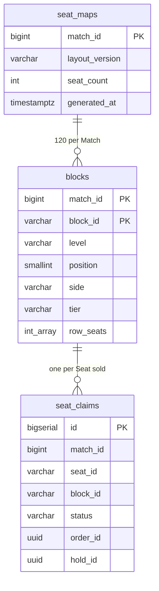
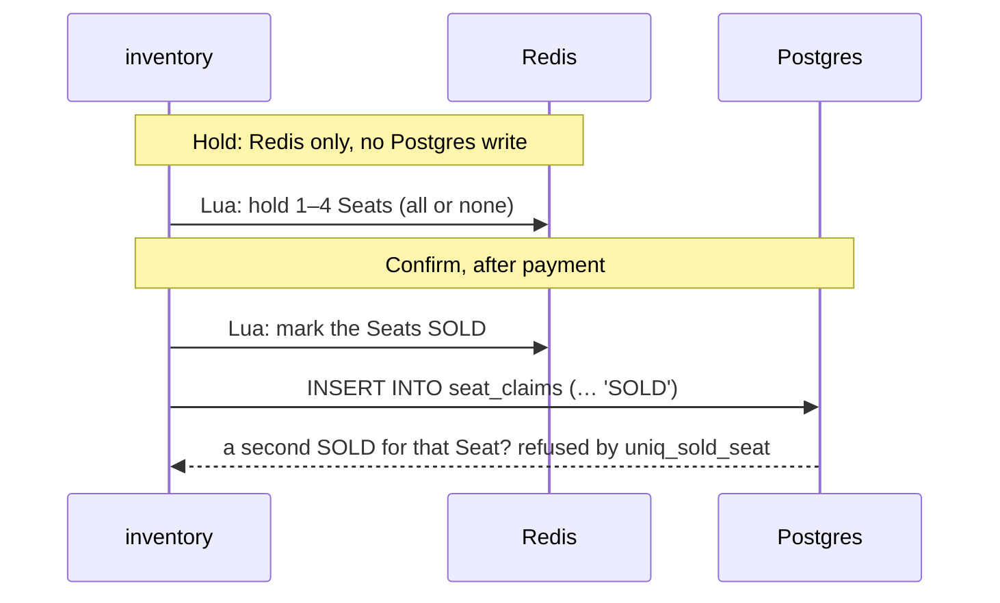

## Part 1 — The Concept

### The story: 60,560 Seats without 60,560 rows

This is the problem-solving story of the ticket. Tell it like this in an interview:

> "My first plan kept **5,000 Seats** per Match, one row each, because it was easy to run
> on a laptop. Then the frontend drew the real stadium, **60,560 Seats** in 120 Blocks,
> and the backend had to describe the same stadium. My first idea was to create a Seat
> row only when a Fan books it. I rejected it for three reasons: it **writes Postgres on
> the hold path**, which the design forbids; two Fans could create the same Seat at the
> same moment; and checking that a Seat id is real still needs the whole layout. So I
> stored the **layout** instead: 120 Block rows, each with the number of Seats in every
> Row. A Seat is valid when its Block exists and its Row and number fit. Postgres sees
> the stadium once, and after that **only the real sales**."

The numbers, measured on Postgres 18.7 for one Match (you measure them yourself in Step 9):

| Way to store it | Rows per Match | Size on disk |
|---|---|---|
| One row per Seat | 60,560 | ≈ 6.8 MB |
| **The layout: one row per Block** (ADR-0007) | **120** | **≈ 88 kB** |

The second half of the ticket is the **backstop**. Redis decides who gets a Seat
(ADR-0001), but if Redis is ever wrong (lost after a restart, a bug in a script), the
database must still refuse to **sell the same Seat twice**. One partial unique index does
that.

**Done looks like:**
- [ ] Starting `inventory` runs Flyway, which creates `seat_maps`, `blocks` and `seat_claims` as version 1. There is no `seats` table.
- [ ] Bad Blocks are rejected: unknown `level`, `side` or `tier`, a position outside 0–39, no Rows, or a Row of zero Seats.
- [ ] A second SOLD claim for the same Seat of the same Match is rejected. After a CANCELLED claim, a new SOLD claim is accepted.
- [ ] A Seat Claim whose Seat id names another Block, or whose Block doesn't exist, is rejected.
- [ ] With Postgres stopped, `inventory` now **fails to start** (slice 1 started anyway).

### The big picture

The three tables, and how many rows each one gets:



Where the backstop sits in a sale (built in Sprint 4–5; this ticket builds the last line):



How one Block row describes its Seats (Block 214: Club Level, north stand behind the goal, so Tier VIP 2; front Row first):

```text
blocks row: match_id=1  block_id='214'  row_seats = {22,22,23,23,23,23,24,24,24,24,25,25}

Row      R01 R02 R03 R04 R05 R06 R07 R08 R09 R10 R11 R12
Seats     22  22  23  23  23  23  24  24  24  24  25  25
                                 ▲ Row 07 has 24 Seats

Seat id '214-R07-12':
  Block 214 exists in this Match?   → the database (foreign key + regex)
  Row 07 ≤ 12 Rows? Seat 12 ≤ 24?   → Java, SeatMap.contains (TKT-104)
```

### Ways to build it

| Option | How it works | When it wins |
|---|---|---|
| **Flyway, versioned SQL files** | `V1__seat_map.sql` runs once per database; a history table records it | you want exact Postgres DDL: partial indexes, `INT[]`, regex CHECKs |
| Hibernate `ddl-auto=update` | Hibernate creates or alters tables from the entities | never for us: no partial indexes or regex CHECKs, no history, and it can't safely change a live table |
| Liquibase | changesets in XML or YAML, translated per database | a product that must run on several databases |

### What we chose and why

**Flyway with plain SQL, tested with plain SQL.**
- The backstop **is** Postgres DDL (`CREATE UNIQUE INDEX … WHERE status = 'SOLD'`). Only
  hand-written SQL says exactly that.
- The tests talk to the database through `JdbcClient`, not through Java entities. That
  way they prove what **the database itself** refuses, whatever the Java code does. JPA
  comes in slice 3 and must match this schema, not the other way round.
- The schema is designed in DATA-MODEL §2. Here each constraint arrives **driven by a
  test**, in four cycles.

### Under the hood

#### Flyway in Boot 4

```text
inventory starts
  └─ FlywayAutoConfiguration (from spring-boot-starter-flyway)
       ├─ opens a connection right away  ← Postgres down? the app stops here
       ├─ reads flyway_schema_history (creates it on the first run)
       ├─ finds db/migration/V1__seat_map.sql on the classpath
       ├─ checksum of V1 == the recorded one?  no → "Validate failed … checksum mismatch"
       └─ not applied yet → run it in a transaction, record version 1
  └─ only then the rest of the app (later: JPA, which expects the tables to exist)
```

- **Name = version + description:** `V1__seat_map.sql`, with **two** underscores. Default
  folder `src/main/resources/db/migration`.
- **A migration is never edited once applied** to a database that matters. Flyway stores
  its checksum, and a changed file stops the app. Before the merge, only your test
  containers (fresh every run) and your Compose database have run it. You reset the
  Compose one with `docker compose down -v`.
- **Boot 4:** you need **`spring-boot-starter-flyway`**. With only `flyway-core`,
  migrations **silently never run** (ADR-0004). Since Flyway 10, Postgres support is a
  separate module: **`flyway-database-postgresql`**. Boot 4.1.2 manages Flyway 12.4.
- **Source:** [Spring Boot — Execute Flyway database migrations on startup](https://docs.spring.io/spring-boot/how-to/data-initialization.html#howto.data-initialization.migration-tool.flyway) and [Flyway — Versioned migrations](https://documentation.red-gate.com/flyway/flyway-concepts/migrations/versioned-migrations)

#### CHECK and foreign-key constraints

- **`CHECK (level IN ('LOWER','CLUB','UPPER'))`**: Postgres evaluates the condition on
  every insert and update, and refuses the row if it's false. Unnamed checks get names like
  `blocks_level_check`, and the error names the one that failed.
- **On an array:** `cardinality(row_seats) > 0 AND array_position(row_seats, NULL) IS NULL
  AND 0 < ALL (row_seats)` means "at least one Row, no Row without a number, and every Row
  has more than zero Seats". A CHECK only refuses a row when its condition is **false**;
  NULL ("unknown") passes, so NULLs have to be ruled out explicitly.
- **A regex that uses another column:** `seat_id ~ ('^' || block_id || '-R[0-9]{2}-[0-9]{1,2}$')`
  makes `215-R07-12` impossible on Block `214`. Plain `CHECK` can see the whole row, so
  two columns can agree or disagree.
- **A composite foreign key:** `FOREIGN KEY (match_id, block_id) REFERENCES blocks` means
  "this Block exists **in this Match**", not just "some Block 214 exists".
- **Source:** [PostgreSQL — Check constraints](https://www.postgresql.org/docs/current/ddl-constraints.html#DDL-CONSTRAINTS-CHECK-CONSTRAINTS)

#### The partial unique index: the overselling backstop

```text
seat_claims                                   uniq_sold_seat  (only rows WHERE status='SOLD')
id  match  seat_id      status                 key (match_id, seat_id)
1   1      214-R07-12   CANCELLED   ─╳ not in the index
2   1      214-R07-12   SOLD        ──▶  (1, 214-R07-12)
3   1      214-R07-12   SOLD        ──▶  (1, 214-R07-12)  already there → ERROR 23505, row refused
4   1      214-R07-13   SOLD        ──▶  (1, 214-R07-13)  different key → fine
```

- **Why partial:** a plain `UNIQUE (match_id, seat_id)` would also block a SOLD claim after
  a CANCELLED one, and a cancelled sale must be able to sell again. The `WHERE` clause puts
  only SOLD rows in the index, so the rule is exactly "at most one SOLD claim per Seat".
- **Under concurrency:** two transactions insert the same SOLD Seat at the same moment. The
  second one **waits** until the first commits, then fails. It never slips through. That is
  why this is a backstop, not just a check.
- **Source:** [PostgreSQL — Partial Indexes](https://www.postgresql.org/docs/current/indexes-partial.html) (example: a unique index on a subset of rows) and [Index Uniqueness Checks](https://www.postgresql.org/docs/current/index-unique-checks.html)

#### `@JdbcTest` and Spring's exception translation

- **`@JdbcTest` is a slice:** it starts only the JDBC part of the app (DataSource,
  `JdbcClient`, transactions, **and Flyway**), not the web layer. Each test runs in a
  transaction that is **rolled back** at the end, so tests don't see each other's rows.
- **It keeps your container.** `@AutoConfigureTestDatabase` replaces the DataSource with an
  in-memory database by default, but (since Boot 3.4) not one that comes from a test
  `@ServiceConnection`. I checked this on 4.1.2.
- **Spring translates the Postgres error code** (SQLState) into its own exception, the
  same for every database:

```text
DataAccessException
 └─ NonTransientDataAccessException
     └─ DataIntegrityViolationException     ← 23514 CHECK · 23503 foreign key · 23502 NOT NULL
         └─ DuplicateKeyException           ← 23505 unique (our backstop)
```

- **When it's thrown:** `JdbcClient` sends the statement immediately, so the exception
  comes from `.update()` itself. With JPA (slice 3) it comes later, at **flush**.
- **Source:** [Spring Boot — Auto-configured JDBC tests](https://docs.spring.io/spring-boot/reference/testing/spring-boot-applications.html#testing.spring-boot-applications.autoconfigured-jdbc) and [Spring Framework — SQLExceptionTranslator](https://docs.spring.io/spring-framework/reference/data-access/jdbc/core.html#jdbc-SQLExceptionTranslator)

---

## Part 2 — The Implementation

**The seam** is the database itself: SQL in through `JdbcClient`, and a refused row out.
- **It catches** a missing table, a constraint that is missing or too strict (a full
  `UNIQUE` instead of the partial index), a wrong constraint name.
- **It misses** the Java mapping (slice 3), and whether a Row and Seat number fit
  `row_seats`. That check is Java (`SeatMap.contains`, TKT-104).

How the tests move, cycle by cycle:

```text
cycle                       test(s)                                        red because…
──────────────────────────  ─────────────────────────────────────────────  ─────────────────────────────
A  tables (Steps 2–3)       createsTheLayoutTablesAndNoSeatsTable          no migration: no tables
B  Block rules (Step 4)     rejectsAnInvalidBlock ×7, rejectsASeatMapWithNoSeats  no CHECKs: bad rows go in
C  backstop (Steps 5–6)     rejectsASecondSoldClaim…                       no unique rule
                            acceptsASoldClaimAfterACancelledOne            a full UNIQUE is too strict
                            acceptsSoldClaimsForDifferentSeats (guard)     green at once: break it once
D  Claim ↔ Block (Step 7)   3 tests: other Block, missing Block, status    no FK, no regex, no status CHECK
```

### Before you start: slice 1 must be green in CI

Your last push (`e12c710`) is **red in CI**, with `503 SERVICE_UNAVAILABLE` and
`Connection refused`. The cause: both test classes have `@ImportTestcontainers`, not
`@Import(TestcontainersConfiguration.class)`. Those are two different annotations:

```text
@ImportTestcontainers
    imports static Container FIELDS declared on the test class
    → our tests declare none → nothing is imported
@Import(TestcontainersConfiguration.class)
    imports the @Bean method that starts Postgres   ← this one
```

Without a container, the tests used `application.yaml`'s `localhost:5432`, which is your
Compose database. Green on your laptop, refused in CI. That is the Step 6 warning from
TKT-103-1, and CI caught it. Fix it first:

> ⚠️ **Warning — prove it on your laptop first.** Stop Compose, so no test can quietly use it:
> ```bash
> docker compose stop postgres
> ```

In **both** `HealthEndpointTest` and `InventoryApplicationTests`, replace
`@ImportTestcontainers` (and its import line) with:

```java
import org.springframework.context.annotation.Import;

@Import(TestcontainersConfiguration.class)
```

```bash
./mvnw -pl services/inventory test
docker compose start postgres
```

> ✅ **Expected:** `Tests run: 3, Failures: 0, Errors: 0`, with Compose **stopped**, so
> the database the tests used can only have been the container.

```bash
git add services/inventory/src/test/java/com/stadium/inventory/HealthEndpointTest.java
git add services/inventory/src/test/java/com/stadium/inventory/InventoryApplicationTests.java
git commit -m "fix(inventory): start a Postgres container for the tests"
git push
```

> ✅ **Expected:** `build` on PR #47 goes green.

### Step 1 — Add Flyway

On **start.spring.io** (same settings as before: Maven · Java · Boot **4.1.2** · Group
`com.stadium` · Artifact `inventory` · Jar · Java **21** · YAML), add **Flyway Migration**
together with **PostgreSQL Driver**, press **Explore**, and copy only these three into
`services/inventory/pom.xml`:

| Dependency (as Explore shows it) | Scope | What it pulls in |
|---|---|---|
| `spring-boot-starter-flyway` | compile | Flyway 12.4 and Boot's auto-configuration that runs it at startup |
| `org.flywaydb:flyway-database-postgresql` | compile | Flyway's Postgres support (a separate module since Flyway 10) |
| `spring-boot-starter-flyway-test` | test | Flyway inside test slices such as `@JdbcTest` |

> ⚠️ **Warning — not `flyway-core` alone.** In Boot 4 it compiles, starts, and **never
> migrates**, without any error (ADR-0004). And without `flyway-database-postgresql`,
> startup fails with `Unsupported Database: PostgreSQL 18.7`.

Make the Testcontainers config reachable from other packages. In
`TestcontainersConfiguration.java` put `public` in front of the class:

```java
@TestConfiguration(proxyBeanMethods = false)
public class TestcontainersConfiguration {
```

### Step 2 — Cycle A, red: the tables don't exist

```text
services/inventory/src/
├── main/resources/db/migration/
│   └── V1__seat_map.sql                         ← new in Step 3
└── test/java/com/stadium/inventory/
    ├── TestcontainersConfiguration.java         ← now public
    └── adapter/persistence/
        └── SeatMapSchemaTest.java               ← new
```

Create `SeatMapSchemaTest.java`. The helpers insert rows the way the real code will later;
the first test lists the tables:

```java
package com.stadium.inventory.adapter.persistence;

import static org.assertj.core.api.Assertions.assertThat;
import static org.assertj.core.api.Assertions.assertThatThrownBy;

import com.stadium.inventory.TestcontainersConfiguration;
import java.util.List;
import java.util.UUID;
import org.junit.jupiter.api.Test;
import org.springframework.beans.factory.annotation.Autowired;
import org.springframework.boot.jdbc.test.autoconfigure.JdbcTest;
import org.springframework.context.annotation.Import;
import org.springframework.jdbc.core.simple.JdbcClient;

@JdbcTest
@Import(TestcontainersConfiguration.class)
class SeatMapSchemaTest {

    @Autowired
    JdbcClient jdbc;

    @Test
    void createsTheLayoutTablesAndNoSeatsTable() {
        List<String> tables = jdbc.sql("""
                SELECT table_name FROM information_schema.tables
                WHERE table_schema = 'public' AND table_name <> 'flyway_schema_history'
                """).query(String.class).list();

        assertThat(tables).containsExactlyInAnyOrder("seat_maps", "blocks", "seat_claims");
    }

    private void aSeatMap(long matchId) {
        jdbc.sql("""
                INSERT INTO seat_maps (match_id, layout_version, seat_count, generated_at)
                VALUES (?, 'stadium-v1', 60560, now())
                """).params(matchId).update();
    }

    private void aBlock(long matchId, String blockId, String level, int position,
                        String side, String tier, String rowSeats) {
        jdbc.sql("""
                INSERT INTO blocks (match_id, block_id, level, position, side, tier, row_seats)
                VALUES (?, ?, ?, ?, ?, ?, ?::int[])
                """)
                .params(matchId, blockId, level, position, side, tier, rowSeats)
                .update();
    }

    private void block214() {
        aSeatMap(1);
        aBlock(1, "214", "CLUB", 13, "NORTH", "VIP_2",
               "{22,22,23,23,23,23,24,24,24,24,25,25}");
    }

    private void aClaim(long matchId, String blockId, String seatId, String status) {
        jdbc.sql("""
                INSERT INTO seat_claims (match_id, seat_id, block_id, status, order_id, hold_id)
                VALUES (?, ?, ?, ?, ?, ?)
                """)
                .params(matchId, seatId, blockId, status, UUID.randomUUID(), UUID.randomUUID())
                .update();
    }
}
```

```bash
./mvnw -pl services/inventory test -Dtest=SeatMapSchemaTest
```

> ✅ **Expected (the right red):** the query works, and the list is empty:
> ```text
> Expecting actual:
>   []
> to contain exactly in any order:
>   ["seat_maps", "blocks", "seat_claims"]
> ```

### Step 3 — Cycle A, green: V1 with the tables

Create `services/inventory/src/main/resources/db/migration/V1__seat_map.sql`. For now:
columns, keys and the Block → Seat Map foreign key. **No CHECKs and no unique index yet**;
the next cycles' tests ask for them.

```sql
-- TKT-103: the layout of a Match's stadium (ADR-0007) and one Seat Claim per sale.
CREATE TABLE seat_maps (
    match_id        BIGINT      PRIMARY KEY,
    layout_version  VARCHAR(32) NOT NULL,
    seat_count      INT         NOT NULL,
    generated_at    TIMESTAMPTZ NOT NULL
);

CREATE TABLE blocks (
    match_id   BIGINT      NOT NULL REFERENCES seat_maps(match_id),
    block_id   VARCHAR(3)  NOT NULL,
    level      VARCHAR(8)  NOT NULL,
    position   SMALLINT    NOT NULL,
    side       VARCHAR(8)  NOT NULL,
    tier       VARCHAR(16) NOT NULL,
    row_seats  INT[]       NOT NULL,
    PRIMARY KEY (match_id, block_id),
    UNIQUE (match_id, level, position)
);

CREATE TABLE seat_claims (
    id          BIGSERIAL   PRIMARY KEY,
    match_id    BIGINT      NOT NULL,
    seat_id     VARCHAR(16) NOT NULL,
    block_id    VARCHAR(3)  NOT NULL,
    status      VARCHAR(16) NOT NULL,
    order_id    UUID        NOT NULL,
    hold_id     UUID        NOT NULL,
    created_at  TIMESTAMPTZ NOT NULL DEFAULT now()
);

-- Deliberately no seats table (ADR-0007) and no holds table: Holds are Redis-only (ADR-0001).
```

> ⚠️ **Warning — the file name.** `V1__seat_map.sql`: capital `V`, **two** underscores.
> `V1_seat_map.sql` is not a migration to Flyway: it's skipped without an error, and the
> test stays red.

```bash
./mvnw -pl services/inventory test
```

> ✅ **Expected:** `Tests run: 4, Failures: 0, Errors: 0`. The test log shows Flyway at work:
> ```text
> … Migrating schema "public" to version "1 - seat map"
> … Successfully applied 1 migration to schema "public", now at version v1
> ```

```bash
git add services/inventory/pom.xml
git add services/inventory/src/main/resources/db/migration/V1__seat_map.sql
git add services/inventory/src/test/java/com/stadium/inventory/TestcontainersConfiguration.java
git add services/inventory/src/test/java/com/stadium/inventory/adapter/persistence/SeatMapSchemaTest.java
git commit -m "feat(inventory): create the Seat Map tables with Flyway"
```

### Step 4 — Cycle B: the database rejects bad Blocks (🔴 → 🟢)

Add to `SeatMapSchemaTest` (imports: `org.junit.jupiter.params.ParameterizedTest`,
`org.junit.jupiter.params.provider.CsvSource`, `org.springframework.dao.DataIntegrityViolationException`):

```java
    @ParameterizedTest(name = "{0}")
    @CsvSource(delimiter = '|', textBlock = """
            unknown level       | MIDDLE | 13 | WEST   | VIP_1 | {22,22,23} | blocks_level_check
            position past 39    | CLUB   | 40 | WEST   | VIP_1 | {22,22,23} | blocks_position_check
            unknown side        | CLUB   | 13 | INSIDE | VIP_1 | {22,22,23} | blocks_side_check
            unknown tier        | CLUB   | 13 | WEST   | GOLD  | {22,22,23} | blocks_tier_check
            no Rows             | CLUB   | 13 | WEST   | VIP_1 | {}         | blocks_row_seats_check
            a Row of zero Seats | CLUB   | 13 | WEST   | VIP_1 | {22,0,23}  | blocks_row_seats_check
            a Row with no count | CLUB   | 13 | WEST   | VIP_1 | {22,NULL}  | blocks_row_seats_check
            """)
    void rejectsAnInvalidBlock(String why, String level, int position, String side,
                               String tier, String rowSeats, String constraint) {
        aSeatMap(1);

        assertThatThrownBy(() -> aBlock(1, "214", level, position, side, tier, rowSeats))
                .isInstanceOf(DataIntegrityViolationException.class)
                .hasMessageContaining(constraint);
    }

    @Test
    void rejectsASeatMapWithNoSeats() {
        assertThatThrownBy(() -> jdbc.sql("""
                INSERT INTO seat_maps (match_id, layout_version, seat_count, generated_at)
                VALUES (1, 'stadium-v1', 0, now())
                """).update())
                .isInstanceOf(DataIntegrityViolationException.class)
                .hasMessageContaining("seat_maps_seat_count_check");
    }
```

Run it: **🔴 expected** is `Tests run: 10, Failures: 9`: the 8 Block cases and the Seat Map case each fail with `Expecting code to raise a throwable.`
Without CHECKs, every bad row goes in.

**🟢 Green:** in `V1__seat_map.sql`, **replace** each of these column lines inside its `CREATE TABLE` with the version that has a CHECK (don’t add them at the end of the file: outside a table they are a syntax error):

```sql
    seat_count      INT         NOT NULL CHECK (seat_count > 0),
```
```sql
    level      VARCHAR(8)  NOT NULL CHECK (level IN ('LOWER','CLUB','UPPER')),
    position   SMALLINT    NOT NULL CHECK (position BETWEEN 0 AND 39),
    side       VARCHAR(8)  NOT NULL CHECK (side IN ('WEST','NORTH','EAST','SOUTH')),
    tier       VARCHAR(16) NOT NULL
               CHECK (tier IN ('CLUB_PREMIUM','VIP_1','VIP_2','STANDARD')),
    row_seats  INT[]       NOT NULL
               CHECK (cardinality(row_seats) > 0
                      AND array_position(row_seats, NULL) IS NULL   -- no Row without a number
                      AND 0 < ALL (row_seats)),
```

> ⚠️ **Warning — a CHECK passes when its condition is NULL, not only when it's true.**
> `0 < ALL ('{22,NULL}')` is NULL ("unknown"), so without the middle line `{22,NULL}` would
> go in. That's what the `a Row with no count` case catches.

> ⚠️ **Warning — editing V1 is fine now, and only now.** The test containers are new on
> every run, so they always run the current V1. But if you start the app against Compose
> (Step 8) **before** you finish editing V1, Compose has the old checksum and startup
> fails with `Migration checksum mismatch for migration version 1`. Then reset it with
> `docker compose down -v` and `docker compose up -d`. Once V1 is on `main`, it's frozen:
> a change becomes `V2__….sql`.

> ✅ **Expected:** `Tests run: 13, Failures: 0` (3 from slice 1, 10 in `SeatMapSchemaTest`).

```bash
git add services/inventory/src/main/resources/db/migration/V1__seat_map.sql
git add services/inventory/src/test/java/com/stadium/inventory/adapter/persistence/SeatMapSchemaTest.java
git commit -m "feat(inventory): reject invalid Seat Maps and Blocks in the database"
```

### Step 5 — Cycle C, first test: a second SOLD claim is refused

Add (import `org.springframework.dao.DuplicateKeyException`):

```java
    @Test
    void rejectsASecondSoldClaimForTheSameSeat() {
        block214();
        aClaim(1, "214", "214-R07-12", "SOLD");

        assertThatThrownBy(() -> aClaim(1, "214", "214-R07-12", "SOLD"))
                .isInstanceOf(DuplicateKeyException.class);
    }
```

**🔴 expected:** `Expecting code to raise a throwable.` Nothing stops a double sale yet.

**🟢 The simplest thing that passes**: do it on purpose, and see what the next test says.
At the end of the `seat_claims` columns, add:

```sql
    created_at  TIMESTAMPTZ NOT NULL DEFAULT now(),
    UNIQUE (match_id, seat_id)
```

> ✅ **Expected:** green. Don't commit yet; the next test shows this is too strict.

### Step 6 — Cycle C: a cancelled sale can be sold again

```java
    @Test
    void acceptsASoldClaimAfterACancelledOne() {
        block214();
        aClaim(1, "214", "214-R07-12", "CANCELLED");

        aClaim(1, "214", "214-R07-12", "SOLD");

        assertThat(jdbc.sql("SELECT count(*) FROM seat_claims WHERE seat_id = '214-R07-12'")
                .query(Long.class).single()).isEqualTo(2);
    }

    @Test
    void acceptsSoldClaimsForDifferentSeats() {
        block214();
        aClaim(1, "214", "214-R07-12", "SOLD");
        aClaim(1, "214", "214-R07-13", "SOLD");
        aClaim(1, "214", "214-R08-12", "SOLD");

        assertThat(jdbc.sql("SELECT count(*) FROM seat_claims").query(Long.class).single()).isEqualTo(3);
    }
```

> ✅ **Expected (the right red):** the cancelled test fails, refused by the plain UNIQUE:
> ```text
> org.springframework.dao.DuplicateKeyException: …
>   ERROR: duplicate key value violates unique constraint "seat_claims_match_id_seat_id_key"
>   Detail: Key (match_id, seat_id)=(1, 214-R07-12) already exists.
> ```

**🟢 Green:** remove the `UNIQUE (match_id, seat_id)` line (and the comma before it), and
add the backstop at the end of the file:

```sql
-- The overselling backstop: at most one SOLD claim per Seat of a Match.
CREATE UNIQUE INDEX uniq_sold_seat ON seat_claims (match_id, seat_id)
    WHERE status = 'SOLD';
```

Tighten the first test so it names the backstop:

```java
                .isInstanceOf(DuplicateKeyException.class)
                .hasMessageContaining("uniq_sold_seat");
```

> ✅ **Expected:** all green.

**`acceptsSoldClaimsForDifferentSeats` was green from the start, so prove it can fail.**
Make the index too broad for a moment, `ON seat_claims (match_id) WHERE status = 'SOLD'`,
run it, see `DuplicateKeyException … uniq_sold_seat`, then put `(match_id, seat_id)` back.

```bash
git add services/inventory/src/main/resources/db/migration/V1__seat_map.sql
git add services/inventory/src/test/java/com/stadium/inventory/adapter/persistence/SeatMapSchemaTest.java
git commit -m "feat(inventory): refuse a second SOLD claim for the same Seat"
```

### Step 7 — Cycle D: a Seat Claim belongs to a real Block

```java
    @Test
    void rejectsAClaimWhoseSeatIdNamesAnotherBlock() {
        block214();

        assertThatThrownBy(() -> aClaim(1, "214", "215-R07-12", "SOLD"))
                .isInstanceOf(DataIntegrityViolationException.class)
                .hasMessageContaining("seat_claims_check");
    }

    @Test
    void rejectsAClaimForABlockThatDoesNotExist() {
        block214();

        assertThatThrownBy(() -> aClaim(1, "999", "999-R01-01", "SOLD"))
                .isInstanceOf(DataIntegrityViolationException.class)
                .hasMessageContaining("seat_claims_match_id_block_id_fkey");
    }

    @Test
    void rejectsAnUnknownClaimStatus() {
        block214();

        assertThatThrownBy(() -> aClaim(1, "214", "214-R07-12", "HELD"))
                .isInstanceOf(DataIntegrityViolationException.class)
                .hasMessageContaining("seat_claims_status_check");
    }
```

**🔴 expected:** all three `Expecting code to raise a throwable.`

**🟢 Green:** in `seat_claims`, give `status` its CHECK, and end the column list with the
foreign key and the regex:

```sql
    status      VARCHAR(16) NOT NULL CHECK (status IN ('SOLD','CANCELLED')),
```
```sql
    created_at  TIMESTAMPTZ NOT NULL DEFAULT now(),
    FOREIGN KEY (match_id, block_id) REFERENCES blocks(match_id, block_id),
    -- the Seat id names its own Block; whether Row and number fit is checked in Java
    CHECK (seat_id ~ ('^' || block_id || '-R[0-9]{2}-[0-9]{1,2}$'))
```

> ✅ **Expected:** `Tests run: 19, Failures: 0, Errors: 0`. Your V1 now matches DATA-MODEL §2
> line for line. Compare them once.

```bash
git add services/inventory/src/main/resources/db/migration/V1__seat_map.sql
git add services/inventory/src/test/java/com/stadium/inventory/adapter/persistence/SeatMapSchemaTest.java
git commit -m "feat(inventory): check that a Seat Claim names its own Block"
git push
```

### Step 8 — Run it against Compose, then pull the plug again

```bash
./mvnw -pl services/inventory spring-boot:run
```

> ✅ **Expected:** the same two Flyway lines as in Step 3, now against `inventory_db`.
> Check the tables in a second terminal:
> ```bash
> docker compose exec postgres psql -U stadium -d inventory_db -c "\dt"
> ```
> ```text
>  public | blocks                | table | stadium
>  public | flyway_schema_history | table | stadium
>  public | seat_claims           | table | stadium
>  public | seat_maps             | table | stadium
> ```

Now the slice-1 experiment again: stop the app (Ctrl+C), `docker compose stop postgres`,
and start the app.

> ✅ **Expected — the answer changed:** in slice 1 the app started with no database. Now
> Flyway needs a connection **before** anything else, so startup stops:
> ```text
> … Error creating bean with name 'flywayInitializer' …:
>   Unable to obtain connection from database: Connection to localhost:5432 refused. …
> ```
> Note this in the PR description (an acceptance criterion), then `docker compose start postgres`.

### Step 9 — Measure the story yourself

With the app stopped and Compose running, open psql and paste the block below. It builds
one real Match layout and a "one row per Seat" table side by side, measures both, and
**rolls everything back**:

```bash
docker compose exec postgres psql -U stadium -d inventory_db
```

```sql
BEGIN;
INSERT INTO seat_maps VALUES (999, 'measure', 60560, now());
WITH lv(level, base, rows_n, front, back) AS (
    VALUES ('LOWER', 100, 24, 18, 24), ('CLUB', 200, 12, 22, 25), ('UPPER', 300, 28, 22, 30))
INSERT INTO blocks (match_id, block_id, level, position, side, tier, row_seats)
SELECT 999, (base + p + 1)::text, level, p, 'WEST', 'STANDARD',
       ARRAY(SELECT round(front + (back - front) * r::numeric / (rows_n - 1))::int
             FROM generate_series(0, rows_n - 1) r)
FROM lv, generate_series(0, 39) p;
CREATE TEMP TABLE seats_naive (match_id BIGINT, seat_id VARCHAR(16), block_id VARCHAR(3),
                               tier VARCHAR(16), PRIMARY KEY (match_id, seat_id)) ON COMMIT DROP;
INSERT INTO seats_naive
SELECT b.match_id, b.block_id || '-R' || lpad(r::text, 2, '0') || '-' || s, b.block_id, b.tier
FROM blocks b, generate_series(1, cardinality(b.row_seats)) r, generate_series(1, b.row_seats[r]) s
WHERE b.match_id = 999;
SELECT (SELECT count(*) FROM blocks WHERE match_id = 999) AS block_rows,
       pg_size_pretty(pg_total_relation_size('blocks'))   AS blocks_size,
       (SELECT count(*) FROM seats_naive)                 AS seat_rows,
       pg_size_pretty(pg_total_relation_size('seats_naive')) AS seats_size;
ROLLBACK;
```

> ✅ **Expected** (sizes may differ by a few kB):
> ```text
>  block_rows | blocks_size | seat_rows | seats_size
> ------------+-------------+-----------+------------
>         120 | 88 kB       |     60560 | 6952 kB
> ```
> The layout formula is DATA-MODEL §2's: Rows grow evenly from front to back. Its total is
> exactly 60,560. Put both numbers in the PR description: they're the evidence for the story.

Type `\q` to leave psql. **Slice 2 is done.** Paste me the Step 6 red, the Step 8 startup
failure, and your Step 9 numbers. Then comes TKT-103-3: JPA maps these tables.

#### If it goes wrong

| What you see | Where | What it means |
|---|---|---|
| `Could not connect to Ryuk at localhost:…` | tests | 360 Active Defense is blocking Java on localhost again. Pause it, or trust `java.exe` |
| test stays red, no `Migrating schema` line in the log | tests | the file name: `V1__` with two underscores, under `db/migration` |
| `Unsupported Database: PostgreSQL 18.7` | startup | `flyway-database-postgresql` is missing |
| every test: `Failed to load ApplicationContext`; the first `Caused by:` in `target/surefire-reports/…SeatMapSchemaTest.txt` says `syntax error at or near …` with a `Line` | Flyway | V1 has SQL outside a `CREATE TABLE` (e.g. CHECK lines pasted at the end): fix that line |
| `Migration checksum mismatch for migration version 1` | app against Compose | V1 changed after Compose ran it: `docker compose down -v`, then `up -d` |
| `operator does not exist: integer[] …` or a cast error | `aBlock` | the `?::int[]` cast is missing in the helper's SQL |
| `current transaction is aborted` | a test | a statement after a failed one in the same test: one refused insert per test |

---

## Check yourself

```quiz
Why is the backstop a partial unique index and not UNIQUE (match_id, seat_id)?
- [ ] A partial index is faster to write to under load
- [x] A cancelled sale must be able to sell again
- [ ] Postgres can't put a plain UNIQUE on a VARCHAR
> The WHERE status = 'SOLD' clause keeps CANCELLED claims out of the index, so the rule is exactly one SOLD claim per Seat, and a Seat can be resold after a cancellation.
```

```quiz
Two transactions insert a SOLD claim for the same Seat at the same moment. What happens?
- [ ] Both succeed; the later one wins on commit
- [ ] Both fail, and the Fan has to retry the Order
- [x] The second waits for the first, then fails
> Postgres makes the second inserter wait to see whether the first commits. If it does, the second gets a unique violation (23505). A double sale can't slip through.
```

```quiz
You edit V1__seat_map.sql after the app has run it against Compose. What happens at the next start?
- [x] Flyway stops it: the checksum doesn't match
- [ ] Flyway applies the changed lines on top of V1
- [ ] Nothing, since V1 is already marked as applied
> Flyway records each migration's checksum and validates it on startup. Reset a local database with docker compose down -v; on main, a change becomes a new V2 file.
```

```quiz
Which exception does a CHECK violation become through JdbcClient?
- [ ] DuplicateKeyException, like every refused row
- [x] DataIntegrityViolationException, from 23514
- [ ] A raw PSQLException that Spring passes through
> Spring translates the SQLState: 23514 (check), 23503 (foreign key) and 23502 (not null) become DataIntegrityViolationException; 23505 (unique) becomes its subclass DuplicateKeyException.
```

---

_Ask me anything that's unclear — about the lesson, the docs, or what you see in your terminal._
