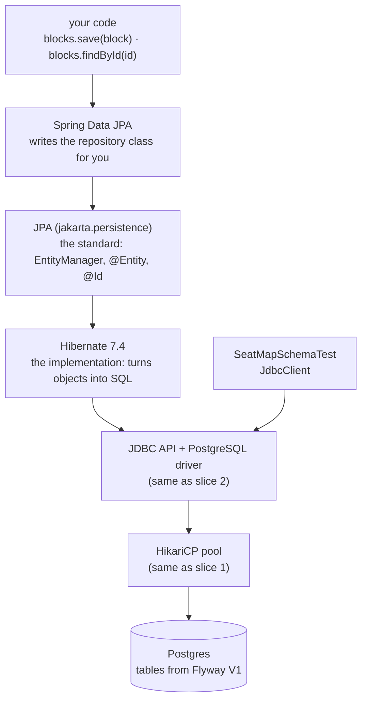

## Part 1 — The Concept

### The story: from rows to objects

At the end of TKT-103-2, Postgres **protects itself**: Flyway's V1 makes the three tables,
and the CHECKs, foreign keys and `uniq_sold_seat` refuse bad data, whatever sends it.
Your tests proved that by talking to Postgres in raw SQL.

But look at the helpers in `SeatMapSchemaTest`. Every insert is a hand-written SQL
string, every column is passed by position, `row_seats` needs a `?::int[]` cast, and
reading a Block back would need code that picks each column out of a row. That's fine
for six test helpers. It's not fine for the application, which from TKT-104 on saves 120
Blocks per Match, reads them back for every Seat Map request, and (TKT-405) writes a
Seat Claim for every sale.

This slice adds the layer that does that work for us: **JPA**. You describe once how
a Java class matches a table, and Hibernate writes the SQL. Two rules keep it honest:
- **Flyway still owns the schema.** Hibernate is set to `validate`: at startup it checks
  every class against the real tables and refuses to start on any mismatch. It never
  creates or changes a table.
- **The slice-2 tests stay.** They keep proving what Postgres enforces. The new tests
  prove that the Java side maps it correctly.

**Done looks like:**
- [ ] `inventory` starts with `ddl-auto: validate` against Flyway's tables, so every mapping matches the schema exactly, including `row_seats` as an array.
- [ ] A Block saved through a repository comes back field for field, read from Postgres (not from memory), with its enums stored as text.
- [ ] A Seat Claim gets its `id` and `created_at` from Postgres.
- [ ] The backstop still refuses a second SOLD claim when it comes through JPA, and you can say **when** the error appears (at `save()` or at `flush()`) and why.

### The big picture: JPA sits on top of JDBC

Nothing from slices 1 and 2 goes away. JPA is a new floor on top of the same building:



| Layer | Like… | What it is |
|---|---|---|
| **JPA** (Jakarta Persistence) | the rules of a game | a **specification**: annotations (`@Entity`, `@Id`…) and the `EntityManager` interface. It has no code that talks to a database |
| **Hibernate** | the team that plays by those rules | the **implementation** of JPA that Boot uses: it reads your annotations, keeps track of your objects, and generates and runs the SQL, through JDBC |
| **Spring Data JPA** | an assistant who writes the boring parts | you declare `interface BlockRepository extends JpaRepository<BlockEntity, BlockId>`, and Spring creates the class at startup, with `save`, `findById`, `findAll`, `delete`, `flush`… |

So JDBC isn't replaced. Hibernate **uses** JDBC, exactly like your `JdbcClient` does.
It just writes the SQL for you.

### Ways to build it

| Option | How it works | When it wins |
|---|---|---|
| **Spring Data JPA + Hibernate** | entities + repositories; Hibernate tracks objects and writes SQL | rich domain objects saved and loaded as a whole (Orders, the saga state, Tickets later), the most common stack in Java jobs |
| `JdbcClient` + hand-written mapping | SQL strings + a `RowMapper` per table | very few tables, or SQL you want to see and tune line by line |
| jOOQ | Java code generated from the schema, type-safe SQL | heavy reporting SQL, where you want SQL's full power with compile-time checks |

### What we chose and why

**Spring Data JPA, with Hibernate validating against Flyway's schema.**
- The rest of the backend (Orders, Payment Attempts, the Confirmation Saga, Tickets) is
  aggregates loaded and saved as a whole. That's JPA's sweet spot, and it's what
  interviewers expect you to know well, including its traps.
- `validate` gives us the safety of both worlds: **Flyway** writes the exact DDL
  (partial index, regex CHECK), and **Hibernate** proves at every startup that the Java
  side still matches it.
- The entities live in **`com.stadium.inventory.adapter.persistence`**, not in
  `domain/`. Domain code stays pure: no annotations, no Hibernate (CLAUDE.md). The pure
  `SeatMap` with `contains` and `offsetOf` comes in TKT-104, and it will be built *from*
  these entities.
- The enums (`Level`, `Side`, `Tier`, `SeatClaimStatus`) are glossary words, so they
  live in **`domain/`** as plain Java enums. The entities use them; they never depend on
  JPA.
- **Rule 8:** `spring-boot-starter-data-jpa` already contains `spring-boot-starter-jdbc`,
  and the JPA test starter contains the JDBC test starter. So the two JDBC lines leave
  the POM, and it lists only what we choose directly.

### Under the hood

#### The persistence context: why SQL is sent later than you think

Hibernate doesn't run an `INSERT` when you call `save()`. It keeps your objects in a
**persistence context**, a per-transaction notebook of "objects I'm managing", and
sends SQL when it has to: at **flush**.

```text
transaction starts
  blocks.save(block)     → notebook: [214 — NEW]            SQL: nothing yet
  block.setTier(VIP_1)   → notebook: [214 — NEW, changed]   SQL: nothing yet
  blocks.findById(214)   → returned from the notebook       SQL: none, Postgres not asked!
  flush (or commit, or a query that needs fresh data)
                         → INSERT INTO blocks … 'VIP_1'     SQL sent now ← constraints checked HERE
transaction commits
```

Three consequences you'll meet in this slice:
- **Dirty checking:** you never call `update()`. Hibernate compares each managed object
  with how it was loaded and writes only what changed, at flush.
- **A test that never leaves Java:** `save` then `findById` in the same transaction
  returns the **same object from the notebook**, without reading Postgres. A round-trip
  test must call `flush()` (send the SQL) **and** `clear()` (empty the notebook) before
  reading back.
- **Errors appear at flush:** a CHECK violation in a Block is only discovered when the
  `INSERT` is sent, at `flush()`, not at `save()`. **One exception:** a table whose id
  comes from the database (`BIGSERIAL` → `IDENTITY`). Hibernate must insert **right away**
  to learn the id, so for Seat Claims the error appears at `save()`. Step 5 shows both.
- **Source:** [Hibernate 7.4 User Guide](https://docs.hibernate.org/orm/7.4/userguide/html_single/) (chapters *Persistence Context* and *Flushing*)

#### Mapping a table to a class

| Column in V1 | Java field | Annotation | Why exactly that |
|---|---|---|---|
| `seat_maps.match_id BIGINT PRIMARY KEY` | `Long matchId` | `@Id` | the key; we set it ourselves (the Match's id) |
| `blocks (match_id, block_id)` primary key | `BlockId id` | `@EmbeddedId` on a `@Embeddable` class | a key made of **two** columns becomes one small class. It needs `equals`/`hashCode` (Hibernate compares keys) and `Serializable` |
| `level VARCHAR(8)` | `Level level` | `@Enumerated(EnumType.STRING)` | stores `'CLUB'`. The default, `ORDINAL`, would store `1` and break the day someone reorders the enum. It's also on the Never list |
| `position SMALLINT` | **`short`** position | `@Column` | `validate` is strict: an `int` field expects `INTEGER` and refuses `SMALLINT` (Step 3 shows the message) |
| `row_seats INT[]` | `int[] rowSeats` | `@Column(name = "row_seats")` | Hibernate 6+ maps Java arrays to Postgres arrays natively: no cast, no converter |
| `generated_at TIMESTAMPTZ` | `Instant generatedAt` | `@Column` | an `Instant` is a moment on the global timeline, like `timestamptz` |
| `seat_claims.id BIGSERIAL` | `Long id` | `@Id @GeneratedValue(strategy = IDENTITY)` | Postgres hands out the number; Hibernate reads it back with `RETURNING id` |
| `order_id UUID` | `UUID orderId` | `@Column` | maps to Postgres's native `uuid` |
| `created_at … DEFAULT now()` | `Instant createdAt` | `@Generated(event = INSERT)` + `@Column(insertable = false, updatable = false)` | Postgres fills it in; Hibernate never writes it and reads it back in the same `RETURNING` |

- **`spring.jpa.hibernate.ddl-auto: validate`:** at startup Hibernate compares every entity
  with the real tables (names, columns, types) and stops the app on the first mismatch.
  Flyway runs **before** Hibernate (Boot orders them), so the tables already exist when it
  checks.
- **Entity rules:** a `protected` no-argument constructor (Hibernate creates objects
  through it), no `final` fields, no Lombok `@Data` (Never list: its `equals`/`hashCode`
  breaks Hibernate's tracking).
- **Source:** [Spring Boot reference — JPA and Spring Data JPA, Entity Classes](https://docs.spring.io/spring-boot/reference/data/sql.html#data.sql.jpa-and-spring-data.entity-classes) and the [Hibernate 7.4 User Guide](https://docs.hibernate.org/orm/7.4/userguide/html_single/) (chapter *Domain Model*: basic types, enums, arrays, embeddable ids, generated values)

#### Spring Data repositories: `save()` is not one thing

You write only the interface. At startup Spring Data creates a **proxy** class for it,
backed by `SimpleJpaRepository`. Two behaviours of that proxy matter here:

```text
blocks.save(entity)
   └─ is the entity new?   (Spring Data looks at the id)
        id == null          → em.persist(entity)   → INSERT at flush (IDENTITY: at once)
        id already set      → em.merge(entity)     → SELECT … WHERE id = ?  then INSERT at flush
```

- **The `SELECT` before the `INSERT`.** Seat Maps and Blocks have ids **we** assign (the
  Match id, the Block number), so Spring Data can't tell they're new and asks Postgres
  first. I checked: saving one Seat Map logs a `select … from seat_maps where match_id=?`
  before the `insert`. Harmless for one row. For TKT-104's 120 Blocks it's 120 extra
  queries, which we'll fix there (`Persistable`).
- **Exception translation.** The proxy catches Hibernate's exceptions and turns them into
  Spring's, the same family as in slice 2: a constraint violation becomes
  `DataIntegrityViolationException`. Through JPA, a unique violation arrives as that
  general type, **not** as `DuplicateKeyException` like with `JdbcClient`, so the tests
  check the constraint **name** in the message.
- **Source:** [Spring Data JPA — Persisting Entities, entity state detection](https://docs.spring.io/spring-data/jpa/reference/jpa/entity-persistence.html)

#### `@DataJpaTest`: the JPA slice

- Starts only JPA: DataSource, Flyway, Hibernate, your repositories and a
  **`TestEntityManager`**. No web layer.
- Every test runs in a transaction that's **rolled back**, like `@JdbcTest`.
- Keeps your Testcontainers Postgres for the same reason as `@JdbcTest` (a
  `@ServiceConnection` DataSource isn't replaced).
- Turns on SQL logging (`spring.jpa.show-sql`), so you **see** every statement
  Hibernate sends. Watch for the `select` before an `insert` and for `returning id,created_at`.
- **Boot 4 packages** (tutorials show the Boot 3 ones):
  `org.springframework.boot.data.jpa.test.autoconfigure.DataJpaTest` and
  `org.springframework.boot.jpa.test.autoconfigure.TestEntityManager`.
- **Source:** [Spring Boot reference — Auto-configured Data JPA Tests](https://docs.spring.io/spring-boot/reference/testing/spring-boot-applications.html#testing.spring-boot-applications.autoconfigured-spring-data-jpa)

---

## Part 2 — The Implementation

**The seam** is a repository round trip in `@DataJpaTest`: save through Spring Data,
`flush` and `clear`, read back from Postgres, compare.
- **It catches** a column mapped to the wrong name or type (startup fails in `validate`),
  an enum stored as a number, an array that doesn't survive the trip, an id or timestamp
  that doesn't come back.
- **It misses** anything about what the Seats *mean*: `SeatMap.contains`, `offsetOf` and
  the generator are TKT-104.

How the tests move:

```text
step                               SeatMapPersistenceTest                  red because…
─────────────────────────────────  ──────────────────────────────────────  ─────────────────────────────
Step 2  Block round trip           aBlockComesBackExactlyAsSaved            Not a managed type
Step 3  green                      ✅ + slice 1–2 tests still ✅
Step 3b break it on purpose        startup fails in validate                int position vs SMALLINT
Step 4  Seat Claim                 aSeatClaimGetsItsIdAndTimeFromPostgres   Not a managed type
Step 5  when errors appear         two learning tests, green at once        (they record behaviour)
```

### Before you start

Slice 2 is done: 19 tests green and PR #47 green. Pause **360 Active Defense** and start
**Docker Desktop**. Compose and the app can stay off until Step 6.

### Step 1 — Swap the JDBC starters for JPA

On **start.spring.io** (Maven · Java · Boot **4.1.2** · `com.stadium` · `inventory` · Jar ·
Java **21** · YAML), add **Spring Data JPA**, press **Explore**, and copy these two:

| Dependency (as Explore shows it) | Scope | What it pulls in |
|---|---|---|
| `spring-boot-starter-data-jpa` | compile | Hibernate 7.4, Jakarta Persistence 3.2, Spring Data JPA **and** `spring-boot-starter-jdbc` (so HikariCP and `JdbcClient` stay) |
| `spring-boot-starter-data-jpa-test` | test | `@DataJpaTest`, `TestEntityManager` **and** `spring-boot-starter-jdbc-test` (so `@JdbcTest` stays) |

Then **delete** `spring-boot-starter-jdbc` and `spring-boot-starter-jdbc-test` from
`services/inventory/pom.xml`: the two new starters already bring them.

In `application.yaml`, under the existing `spring:` key, next to `datasource:`:

```yaml
  jpa:
    hibernate:
      ddl-auto: validate
    open-in-view: false
```

| Line | Why |
|---|---|
| `ddl-auto: validate` | Hibernate checks, never creates. Flyway owns the schema |
| `open-in-view: false` | by default Boot keeps a database connection open for the whole web request, even while the JSON is written. We load what we need in the service and close it. It also silences Boot's startup warning about it |

```bash
./mvnw -pl services/inventory test
```

> ✅ **Expected:** still `Tests run: 19, Failures: 0, Errors: 0`. There are no entities yet,
> so `validate` has nothing to check, and the `@JdbcTest` class works exactly as before.

```bash
git add services/inventory/pom.xml
git add services/inventory/src/main/resources/application.yaml
git commit -m "chore(inventory): add Spring Data JPA and validate the schema"
```

### Step 2 — Cycle A, red: Hibernate doesn't know the Block

```text
services/inventory/src/
├── main/java/com/stadium/inventory/
│   ├── domain/
│   │   ├── Level.java                ← new
│   │   ├── Side.java                 ← new
│   │   └── Tier.java                 ← new
│   └── adapter/persistence/
│       ├── SeatMapEntity.java        ← new
│       ├── SeatMapRepository.java    ← new
│       ├── BlockId.java              ← new
│       ├── BlockEntity.java          ← new
│       └── BlockRepository.java      ← new
└── test/java/com/stadium/inventory/adapter/persistence/
    ├── SeatMapSchemaTest.java        (slice 2, unchanged)
    └── SeatMapPersistenceTest.java   ← new
```

The enums are plain Java, glossary words, in `domain/`:

```java
package com.stadium.inventory.domain;

public enum Level { LOWER, CLUB, UPPER }
```
```java
package com.stadium.inventory.domain;

public enum Side { WEST, NORTH, EAST, SOUTH }
```
```java
package com.stadium.inventory.domain;

public enum Tier { CLUB_PREMIUM, VIP_1, VIP_2, STANDARD }
```

The repositories are complete as they are: Spring Data writes the class.

```java
package com.stadium.inventory.adapter.persistence;

import org.springframework.data.jpa.repository.JpaRepository;

public interface SeatMapRepository extends JpaRepository<SeatMapEntity, Long> {
}
```
```java
package com.stadium.inventory.adapter.persistence;

import org.springframework.data.jpa.repository.JpaRepository;

public interface BlockRepository extends JpaRepository<BlockEntity, BlockId> {
}
```

The entities start as **plain classes, no annotations yet**: fields, the constructors and
getters the test needs. In Step 3 you add the mapping.

```java
package com.stadium.inventory.adapter.persistence;

import java.time.Instant;

public class SeatMapEntity {

    private Long matchId;
    private String layoutVersion;
    private int seatCount;
    private Instant generatedAt;

    protected SeatMapEntity() {
    }

    public SeatMapEntity(Long matchId, String layoutVersion, int seatCount, Instant generatedAt) {
        this.matchId = matchId;
        this.layoutVersion = layoutVersion;
        this.seatCount = seatCount;
        this.generatedAt = generatedAt;
    }

    public Long getMatchId() { return matchId; }
    public int getSeatCount() { return seatCount; }
    public Instant getGeneratedAt() { return generatedAt; }
}
```
```java
package com.stadium.inventory.adapter.persistence;

import java.io.Serializable;
import java.util.Objects;

public class BlockId implements Serializable {

    private Long matchId;
    private String blockId;

    protected BlockId() {
    }

    public BlockId(Long matchId, String blockId) {
        this.matchId = matchId;
        this.blockId = blockId;
    }

    @Override
    public boolean equals(Object other) {
        return other instanceof BlockId that
                && Objects.equals(matchId, that.matchId)
                && Objects.equals(blockId, that.blockId);
    }

    @Override
    public int hashCode() {
        return Objects.hash(matchId, blockId);
    }
}
```
```java
package com.stadium.inventory.adapter.persistence;

import com.stadium.inventory.domain.Level;
import com.stadium.inventory.domain.Side;
import com.stadium.inventory.domain.Tier;

public class BlockEntity {

    private BlockId id;
    private Level level;
    private short position;
    private Side side;
    private Tier tier;
    private int[] rowSeats;

    protected BlockEntity() {
    }

    public BlockEntity(BlockId id, Level level, short position, Side side, Tier tier, int[] rowSeats) {
        this.id = id;
        this.level = level;
        this.position = position;
        this.side = side;
        this.tier = tier;
        this.rowSeats = rowSeats;
    }

    public BlockId getId() { return id; }
    public Level getLevel() { return level; }
    public short getPosition() { return position; }
    public Side getSide() { return side; }
    public Tier getTier() { return tier; }
    public int[] getRowSeats() { return rowSeats; }
}
```

Now the test:

```java
package com.stadium.inventory.adapter.persistence;

import static org.assertj.core.api.Assertions.assertThat;

import com.stadium.inventory.TestcontainersConfiguration;
import com.stadium.inventory.domain.Level;
import com.stadium.inventory.domain.Side;
import com.stadium.inventory.domain.Tier;
import java.time.Instant;
import org.junit.jupiter.api.Test;
import org.springframework.beans.factory.annotation.Autowired;
import org.springframework.boot.data.jpa.test.autoconfigure.DataJpaTest;
import org.springframework.boot.jpa.test.autoconfigure.TestEntityManager;
import org.springframework.context.annotation.Import;

@DataJpaTest
@Import(TestcontainersConfiguration.class)
class SeatMapPersistenceTest {

    @Autowired
    SeatMapRepository seatMaps;

    @Autowired
    BlockRepository blocks;

    @Autowired
    TestEntityManager entityManager;

    @Test
    void aBlockComesBackExactlyAsSaved() {
        seatMaps.save(new SeatMapEntity(1L, "stadium-v1", 60_560, Instant.parse("2026-11-22T10:00:00Z")));
        blocks.save(new BlockEntity(new BlockId(1L, "214"), Level.CLUB, (short) 13, Side.NORTH, Tier.VIP_2,
                new int[] {22, 22, 23, 23, 23, 23, 24, 24, 24, 24, 25, 25}));
        entityManager.flush();   // send the INSERTs now
        entityManager.clear();   // empty the notebook, so the read below really goes to Postgres

        BlockEntity block = blocks.findById(new BlockId(1L, "214")).orElseThrow();

        assertThat(block.getLevel()).isEqualTo(Level.CLUB);
        assertThat(block.getPosition()).isEqualTo((short) 13);
        assertThat(block.getSide()).isEqualTo(Side.NORTH);
        assertThat(block.getTier()).isEqualTo(Tier.VIP_2);
        assertThat(block.getRowSeats()).containsExactly(22, 22, 23, 23, 23, 23, 24, 24, 24, 24, 25, 25);
        assertThat(entityManager.getEntityManager()
                .createNativeQuery("SELECT tier FROM blocks").getSingleResult())
                .isEqualTo("VIP_2");   // stored as text, not as a number
    }
}
```

> ⚠️ **Warning — `flush()` and `clear()` are the test.** Without them, `findById` returns
> the very object you just saved, straight from the persistence context, and the test
> passes **without ever reading Postgres**. Then it proves nothing about the mapping.

```bash
./mvnw -pl services/inventory test -Dtest=SeatMapPersistenceTest
```

> ✅ **Expected (the right red):** the context can't build the repositories, because
> Hibernate doesn't know these classes. That's exactly the missing behaviour, so it's
> the right red even though it's an exception:
> ```text
> Caused by: java.lang.IllegalArgumentException:
>   Not a managed type: class com.stadium.inventory.adapter.persistence.…Entity
> ```
> The class it names may be the Seat Map or the Block: whichever repository Spring
> builds first.

### Step 3 — Cycle A, green: map the two tables

Add the mapping. Every annotation is in the Part 1 table; here they are in place.

`SeatMapEntity`:

```java
import jakarta.persistence.Column;
import jakarta.persistence.Entity;
import jakarta.persistence.Id;
import jakarta.persistence.Table;

@Entity
@Table(name = "seat_maps")
public class SeatMapEntity {

    @Id
    @Column(name = "match_id")
    private Long matchId;

    @Column(name = "layout_version", nullable = false, length = 32)
    private String layoutVersion;

    @Column(name = "seat_count", nullable = false)
    private int seatCount;

    @Column(name = "generated_at", nullable = false)
    private Instant generatedAt;
```

`BlockId`: annotate the class and its two columns:

```java
import jakarta.persistence.Column;
import jakarta.persistence.Embeddable;

@Embeddable
public class BlockId implements Serializable {

    @Column(name = "match_id")
    private Long matchId;

    @Column(name = "block_id", length = 3)
    private String blockId;
```

`BlockEntity`:

```java
import jakarta.persistence.Column;
import jakarta.persistence.EmbeddedId;
import jakarta.persistence.Entity;
import jakarta.persistence.EnumType;
import jakarta.persistence.Enumerated;
import jakarta.persistence.Table;

@Entity
@Table(name = "blocks")
public class BlockEntity {

    @EmbeddedId
    private BlockId id;

    @Enumerated(EnumType.STRING)
    @Column(nullable = false, length = 8)
    private Level level;

    @Column(nullable = false)
    private short position;

    @Enumerated(EnumType.STRING)
    @Column(nullable = false, length = 8)
    private Side side;

    @Enumerated(EnumType.STRING)
    @Column(nullable = false, length = 16)
    private Tier tier;

    @Column(name = "row_seats", nullable = false)
    private int[] rowSeats;
```

```bash
./mvnw -pl services/inventory test
```

> ✅ **Expected:** `Tests run: 20, Failures: 0, Errors: 0`. In the log you'll see the SQL
> Hibernate wrote for you, including the `select` it runs before each `insert` (Part 1,
> *Spring Data repositories*):
> ```text
> … select sme1_0.match_id, … from seat_maps sme1_0 where sme1_0.match_id=?
> … insert into seat_maps (generated_at,layout_version,seat_count,match_id) values (?,?,?,?)
> … insert into blocks (level,position,row_seats,side,tier,block_id,match_id) values (?,?,?,?,?,?,?)
> ```

**Now prove `validate` really guards the mapping.** Change `private short position;` to
`private int position;` for a moment, run the test class again, and read the cause:

> ✅ **Expected:** the app context refuses to start:
> ```text
> Schema validation: wrong column type encountered in column [position] in table [blocks];
>   found [int2 (Types#SMALLINT)], but expecting [integer (Types#INTEGER)]
> ```
> That's `validate` comparing your Java type with V1's `SMALLINT`. Put `short` back.

```bash
git add services/inventory/src/main/java/com/stadium/inventory/domain/
git add services/inventory/src/main/java/com/stadium/inventory/adapter/persistence/
git add services/inventory/src/test/java/com/stadium/inventory/adapter/persistence/SeatMapPersistenceTest.java
git commit -m "feat(inventory): map Seat Maps and Blocks with JPA"
```

### Step 4 — Cycle B: a Seat Claim, with its id and time from Postgres

New files: `domain/SeatClaimStatus.java`, `adapter/persistence/SeatClaimEntity.java` and
`adapter/persistence/SeatClaimRepository.java`.

```java
package com.stadium.inventory.domain;

public enum SeatClaimStatus { SOLD, CANCELLED }
```
```java
package com.stadium.inventory.adapter.persistence;

import org.springframework.data.jpa.repository.JpaRepository;

public interface SeatClaimRepository extends JpaRepository<SeatClaimEntity, Long> {
}
```

Again, first the plain class:

```java
package com.stadium.inventory.adapter.persistence;

import com.stadium.inventory.domain.SeatClaimStatus;
import java.time.Instant;
import java.util.UUID;

public class SeatClaimEntity {

    private Long id;
    private Long matchId;
    private String seatId;
    private String blockId;
    private SeatClaimStatus status;
    private UUID orderId;
    private UUID holdId;
    private Instant createdAt;

    protected SeatClaimEntity() {
    }

    public SeatClaimEntity(Long matchId, String blockId, String seatId, SeatClaimStatus status,
                           UUID orderId, UUID holdId) {
        this.matchId = matchId;
        this.blockId = blockId;
        this.seatId = seatId;
        this.status = status;
        this.orderId = orderId;
        this.holdId = holdId;
    }

    public Long getId() { return id; }
    public Instant getCreatedAt() { return createdAt; }
}
```

Add to `SeatMapPersistenceTest` (imports: `SeatClaimStatus`, `java.util.UUID`), plus a
helper that builds Block 214 so the claim has its Block:

```java
    @Autowired
    SeatClaimRepository claims;

    @Test
    void aSeatClaimGetsItsIdAndTimeFromPostgres() {
        block214();

        SeatClaimEntity claim = claims.save(new SeatClaimEntity(1L, "214", "214-R07-12",
                SeatClaimStatus.SOLD, UUID.randomUUID(), UUID.randomUUID()));

        assertThat(claim.getId()).isNotNull();          // from BIGSERIAL
        assertThat(claim.getCreatedAt()).isNotNull();   // from DEFAULT now()
    }

    private void block214() {
        seatMaps.save(new SeatMapEntity(1L, "stadium-v1", 60_560, Instant.now()));
        blocks.save(new BlockEntity(new BlockId(1L, "214"), Level.CLUB, (short) 13, Side.NORTH, Tier.VIP_2,
                new int[] {22, 22, 23, 23, 23, 23, 24, 24, 24, 24, 25, 25}));
    }
```

**🔴 Expected:** `Not a managed type: class …SeatClaimEntity`, the same red as Step 2, now
for the claim.

**🟢 Green:** map it. The two new ideas are the id Postgres generates and the column only
Postgres writes:

```java
import jakarta.persistence.Column;
import jakarta.persistence.Entity;
import jakarta.persistence.EnumType;
import jakarta.persistence.Enumerated;
import jakarta.persistence.GeneratedValue;
import jakarta.persistence.GenerationType;
import jakarta.persistence.Id;
import jakarta.persistence.Table;
import org.hibernate.annotations.Generated;
import org.hibernate.generator.EventType;

@Entity
@Table(name = "seat_claims")
public class SeatClaimEntity {

    @Id
    @GeneratedValue(strategy = GenerationType.IDENTITY)
    private Long id;

    @Column(name = "match_id", nullable = false)
    private Long matchId;

    @Column(name = "seat_id", nullable = false, length = 16)
    private String seatId;

    @Column(name = "block_id", nullable = false, length = 3)
    private String blockId;

    @Enumerated(EnumType.STRING)
    @Column(nullable = false, length = 16)
    private SeatClaimStatus status;

    @Column(name = "order_id", nullable = false)
    private UUID orderId;

    @Column(name = "hold_id", nullable = false)
    private UUID holdId;

    @Generated(event = EventType.INSERT)
    @Column(name = "created_at", nullable = false, insertable = false, updatable = false)
    private Instant createdAt;
```

> ✅ **Expected:** green, and the log shows Postgres filling in both values in one round trip:
> ```text
> … insert into seat_claims (block_id,hold_id,match_id,order_id,seat_id,status)
>     values (?,?,?,?,?,?) returning id,created_at
> ```

```bash
git add services/inventory/src/main/java/com/stadium/inventory/domain/SeatClaimStatus.java
git add services/inventory/src/main/java/com/stadium/inventory/adapter/persistence/SeatClaimEntity.java
git add services/inventory/src/main/java/com/stadium/inventory/adapter/persistence/SeatClaimRepository.java
git add services/inventory/src/test/java/com/stadium/inventory/adapter/persistence/SeatMapPersistenceTest.java
git commit -m "feat(inventory): map Seat Claims with their generated id and time"
```

### Step 5 — Learning tests: when does the database say no?

These two don't drive new code. They **record how the framework behaves**, so the next
person (and you, in an interview) can see it rather than guess. They're green straight
away, and that's expected for a learning test.

Add (imports: `assertThatThrownBy`, `org.springframework.dao.DataIntegrityViolationException`):

```java
    @Test
    void theBackstopStillRefusesASecondSoldClaimThroughJpa() {
        block214();
        claims.save(new SeatClaimEntity(1L, "214", "214-R07-12", SeatClaimStatus.SOLD,
                UUID.randomUUID(), UUID.randomUUID()));

        // IDENTITY id: Hibernate must INSERT now to learn the id, so the error comes from save()
        assertThatThrownBy(() -> claims.save(new SeatClaimEntity(1L, "214", "214-R07-12",
                SeatClaimStatus.SOLD, UUID.randomUUID(), UUID.randomUUID())))
                .isInstanceOf(DataIntegrityViolationException.class)
                .hasMessageContaining("uniq_sold_seat");
    }

    @Test
    void aBadBlockIsOnlyRefusedAtFlush() {
        seatMaps.save(new SeatMapEntity(1L, "stadium-v1", 60_560, Instant.now()));
        blocks.save(new BlockEntity(new BlockId(1L, "214"), Level.CLUB, (short) 13, Side.NORTH, Tier.VIP_2,
                new int[] {22, 0, 23}));   // no exception: nothing has been sent yet

        assertThatThrownBy(() -> blocks.flush())
                .isInstanceOf(DataIntegrityViolationException.class)
                .hasMessageContaining("blocks_row_seats_check");
    }
```

```text
claims.save(second)   ── IDENTITY ──▶ INSERT … RETURNING id   ──▶ 23505 at save()
blocks.save(bad)      ── assigned id ─▶ (queued in the notebook)  ──▶ nothing yet
blocks.flush()        ──────────────▶ INSERT INTO blocks …       ──▶ 23514 at flush()
```

> ✅ **Expected:** `Tests run: 23, Failures: 0, Errors: 0`. I ran both on Postgres 18.7:
> the second claim fails inside `save()` with `uniq_sold_seat`, and the bad Block passes
> `save()` and fails at `flush()` with `blocks_row_seats_check`.

> ⚠️ **Warning — this is why "it saved fine" proves nothing with JPA.** A service method
> that calls `save()` and returns can still fail **later**, at commit, outside the method
> that caused it. When a write must be checked on the spot (TKT-405 confirms a sale),
> call `saveAndFlush()`, or let the transaction end inside the method that handles the
> error.

```bash
git add services/inventory/src/test/java/com/stadium/inventory/adapter/persistence/SeatMapPersistenceTest.java
git commit -m "test(inventory): show when JPA sends a refused insert"
git push
```

### Step 6 — Start the real app: validate against Compose

```bash
docker compose up -d
./mvnw -pl services/inventory spring-boot:run
```

> ✅ **Expected:** Flyway first (`Successfully validated 1 migration`: V1 is already in your
> Compose database since TKT-103-2 Step 8), then Hibernate validates all three entities
> against it, then `Started InventoryApplication`. No `Schema validation` error means every
> mapping matches V1 exactly. That's the last acceptance criterion of the issue.

> ⚠️ **Warning — if you tidied V1 since Step 8** (spaces, comments), its checksum changed
> and startup fails with `Migration checksum mismatch`. Reset the local database once:
> `docker compose down -v`, then `docker compose up -d`.

**The ticket is built.** Next: run `/code-review` on the branch, make any refactor commits,
fill in PR #47's description (the acceptance criteria and the proof for each, your Step 9
numbers from TKT-103-2, the startup-without-Postgres result), then `gh pr ready` and tell
me. I review, write the close step on the branch, and say when to merge.

#### If it goes wrong

| What you see | Where | What it means |
|---|---|---|
| `Not a managed type: class …` after Step 3 | tests | the class is missing `@Entity`, or it's outside `com.stadium.inventory` (Boot scans from the application's package down) |
| `Schema validation: missing table [seat_maps]` | startup | Flyway didn't run first: is `spring-boot-starter-flyway` still in the POM? |
| `Schema validation: wrong column type … found [int2 …] expecting [integer …]` | startup | a Java type doesn't match V1 (Step 3) |
| `Schema validation: missing column [rowSeats]` | startup | a field without `@Column(name = "row_seats")`: Hibernate's default name is the field name |
| the round-trip test passes but the log shows no `select … from blocks` | test | `flush()` / `clear()` are missing: the test read from memory |
| `Could not connect to Ryuk` / `header parser received no bytes` | tests | 360 Active Defense again |

---

## Check yourself

```quiz
How do JPA, Hibernate and JDBC relate?
- [ ] JPA replaces JDBC, and Hibernate replaces JPA
- [x] Hibernate implements JPA and talks to JDBC
- [ ] JDBC implements JPA; Hibernate is a test tool
> JPA is the specification (annotations, EntityManager); Hibernate is the implementation Boot uses; it generates SQL and runs it through the same JDBC driver and pool as JdbcClient.
```

```quiz
You save a Block and call findById in the same transaction. Where does the object come from?
- [ ] From Postgres, after a SELECT by primary key
- [x] From the persistence context, no SQL is sent
- [ ] From Hikari's cache of recently read rows
> Hibernate returns the managed object from its persistence context. A real round-trip test must flush() and clear() first.
```

```quiz
Why does a second SOLD claim fail at save() while a bad Block fails at flush()?
- [x] The claim's IDENTITY id forces an immediate INSERT
- [ ] Seat Claims are checked in Java before the insert
- [ ] Blocks have no constraints until the commit runs
> To get a BIGSERIAL id Hibernate must insert right away; a Block's id is assigned by us, so its INSERT waits in the persistence context until flush.
```

```quiz
What does spring.jpa.hibernate.ddl-auto: validate do at startup?
- [ ] Creates missing tables and columns from the entities
- [ ] Drops the schema and lets Flyway create it again
- [x] Compares entities to tables, stops on a mismatch
> Flyway owns the schema; validate only checks that every entity's columns and types match the real tables, and refuses to start if one doesn't.
```

---

_Ask me anything that's unclear — about the lesson, the docs, or what you see in your terminal._
