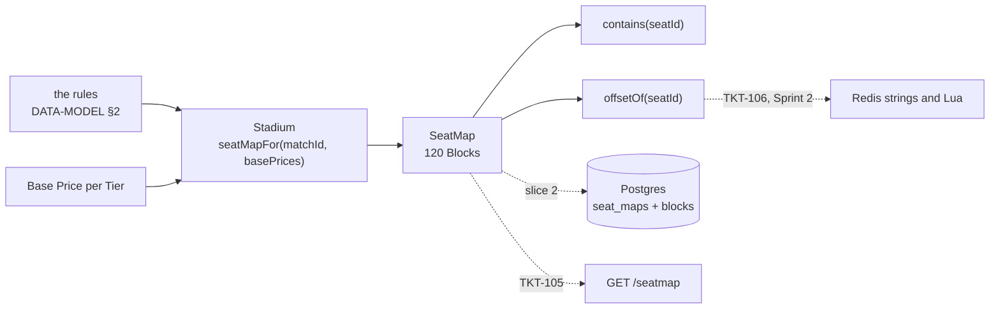

## Part 1 — The Concept

### The story: 60,560 Seats that nobody stores

In TKT-103 you made a choice worth retelling: Postgres stores **120 Block rows per Match**,
not 60,560 Seat rows (ADR-0007). That choice leaves two questions open:

1. **Who fills those 120 rows?** They have to be exactly the stadium the frontend draws. If the
   backend gives Block 214 one Seat more in Row 7 than the frontend does, a Fan clicks one Seat
   and holds another.
2. **If there is no Seat row, how do we know a Seat exists?** In Sprint 2 a Fan sends
   `["214-R07-12"]`. Nothing in Postgres or Redis is called `214-R07-12`. Something has to say
   "yes, it exists, and it's character number 147 of Block 214's string in Redis".

The answer to both is the same thing: **the rules of the stadium, written once, in plain Java.**

```text
a Fan sends        "214-R07-12"
                     │
   contains(...)  →  Block 214 exists? Row 7 exists? Seat 12 ≤ the Seats in Row 7?     → true
   offsetOf(...)  →  Seats in Rows 1–6, plus 11                                        → 147
                     │
   Redis (TKT-106)   match:{1}:states:214 = "AAAA…A…"     character 147 = this Seat
```

This slice is the rules: **no Spring, no database, no Docker.** Slice 2 stores the result.

**Done looks like:**
- [ ] One call gives a Seat Map of 120 Blocks and exactly 60,560 Seats.
- [ ] Rows, Sides, Tiers and Base Prices match DATA-MODEL §2 for every Block you check.
- [ ] `contains` says no to every Seat that doesn't exist, including badly written ids.
- [ ] `offsetOf("214-R07-12")` is 147.
- [ ] Nothing in `domain/` imports Spring, Jakarta or JDBC, and its 59 tests run in about a second.

### The big picture



Solid arrows are this slice. Notice the direction: everything else will depend on `SeatMap`,
and `SeatMap` depends on nothing.

### Ways to build it

| Option | How it works | When it wins |
|---|---|---|
| **Pure Java rules** | a class computes the 120 Blocks from a few numbers | the rules are fixed arithmetic, used on the hot path, and must be testable in milliseconds |
| Compute it in SQL | `generate_series` + `round`, like your Step 9 measurement in TKT-103-2 | a one-off data load; but then Java can't answer `contains` without a query |
| A JSON or CSV file of 120 Blocks | load it at startup | the layout is drawn by hand and has no formula (a theatre, for example) |
| Ask Postgres on every hold | `SELECT row_seats FROM blocks WHERE …` per Seat | almost no traffic; here it puts Postgres on the hold path, which the Never list forbids |

### What we chose and why

**Pure Java.** The stadium *is* a formula: three Levels, each with a number of Rows and a front
and back width. The same formula is already in the frontend
(`frontend/stadium-site/lib/api/mock/seat-map.ts`), and porting it keeps both sides identical.
It's also needed on the **hot path**: every hold request checks and locates its Seats, so it has
to cost nanoseconds, not a round trip.

**The honest trade-off:** the same rules now live in two languages. What keeps them equal isn't
trust, it's **tests with the same literal examples** on both sides (concept 2).

### Under the hood

#### Pure domain vs application service

Two kinds of code look alike and should never be mixed:

| | **Domain** (`domain/`) | **Application service** (`application/`, slice 2) |
|---|---|---|
| Answers | "what is true?" | "what happens, in which order?" |
| Example | Block 214 has 282 Seats | build the Seat Map, open a transaction, store it, say if it existed |
| Depends on | nothing but Java | the domain, plus the store and configuration |
| Test needs | nothing | Spring and a real Postgres |
| Speed of its tests | 59 tests in about 1 second | 20–35 seconds until the first one runs |

*Pure* means: **the result depends only on the arguments.** No clock, no random, no
configuration, no database. That's why the Base Prices are a **parameter**:

```text
❌ Stadium reads stadium.tiers.vip-2.base-price     → the domain knows Spring
✅ Stadium.seatMapFor(1, {VIP_2 = 180.00, …})       → the domain is told; someone else reads YAML
```

- **What it buys:** the same arguments always give an equal Seat Map. "The same layout always
  produces the same Seat Map" is an acceptance criterion, and here it's true by construction.
- **No port, no interface (ADR-0005).** There's one stadium and one way to compute it. A
  `StadiumRules` interface with a single implementation would only be a file to read past.
- **Source:** [Martin Fowler — Domain Model](https://martinfowler.com/eaaCatalog/domainModel.html) and [Service Layer](https://martinfowler.com/eaaCatalog/serviceLayer.html)

#### Porting rules: literal examples, not a second formula

The tempting test is this one:

```java
// ❌ tautological: it computes the answer the same way the code does
assertThat(block.rowSeats().get(6)).isEqualTo((int) Math.round(22 + 3.0 * 6 / 11));
```

If the formula is wrong, the test is wrong **in the same way** and stays green. A test has to
know the answer from **somewhere else**. We have three independent sources:

| Source | Example you copy as a literal |
|---|---|
| ARCHITECTURE §11, the published API example | Block 214 = `22,22,23,23,23,23,24,24,24,24,25,25` |
| DATA-MODEL §2, the stadium table | 504 / 282 / 728 Seats per Block, 60,560 in total |
| the frontend's own rules | the middle of the west side is Club Premium (Block 206) |

A good set of examples sits **at the edges**: first and last Block of a Side, first and last Row,
the Seat after the last one. Bugs live at edges.

- **Source:** HOW-WE-WORK §7 (tautological tests) and the [JUnit user guide — parameterized tests](https://docs.junit.org/current/user-guide/)

#### The row formula, and the division that eats 1,160 Seats

Rows grow evenly from front to back:

```text
seats(row) = round( front + (back − front) × row / (rows − 1) )        row = 0 … rows − 1

Club: front 22, back 25, 12 Rows → (25 − 22) × row / 11

row          0     1     2     3     4     5     6     7     8     9    10    11
exact     22.00 22.27 22.55 22.82 23.09 23.36 23.64 23.91 24.18 24.45 24.73 25.00
round()      22    22    23    23    23    23    24    24    24    24    25    25   ✅ 282
int / int    22    22    22    22    23    23    23    23    24    24    24    25   ❌ 277
```

In Java, `int / int` **throws the fraction away** (it rounds toward zero) *before* any `round()`
sees it. The frontend's JavaScript has only floating-point numbers, so the same-looking line is
right there and wrong here. I ran the wrong version: the stadium has **59,400** Seats instead of
60,560, and it still compiles, starts and looks fine.

- **Why it matters so much:** one Row that is one Seat short **shifts the offset of every Seat
  behind it**. `214-R07-12` becomes 145 instead of 147, so Redis would mark somebody else's Seat.
- **Rounding:** `Math.round` in Java and JavaScript agree for positive numbers (halves go up).
- **Source:** [Java Language Specification §15.17.2 — integer division rounds toward 0](https://docs.oracle.com/javase/specs/jls/se21/html/jls-15.html#jls-15.17.2)

#### A record is only as immutable as what's inside it

One `SeatMap` will be shared by every request thread. A record's fields can't be reassigned,
but a `List` inside it can still be changed by whoever holds the original:

```text
List rows ──────────┐
                    ▼
            [22, 23, 23 …]   ◀────── block.rowSeats()      one list, two owners
rows.set(0, 99)  → block 214 changed too, for every request
```

The fix is a **defensive copy** in the compact constructor: `List.copyOf(...)`. It returns an
unmodifiable list, and if the argument is already one it doesn't copy again.

- **Why `List<Integer>` here and `int[]` in the entity?** An array can always be changed from
  outside, and two arrays with the same numbers aren't `equals`, so two equal Blocks would look
  different. The entity keeps `int[]` because that's what maps to Postgres's `INT[]`. The
  conversion happens at the border, in slice 2.
- **Source:** [Java SE 21 — List, unmodifiable lists](https://docs.oracle.com/en/java/javase/21/docs/api/java.base/java/util/List.html#unmodifiable)

---

## Part 2 — The Implementation

**The seam** is the public methods of `Stadium` and `SeatMap`, called directly from JUnit.
- **It catches** a wrong Block number, Row width, Side, Tier, price or offset, and every Seat id
  that shouldn't exist.
- **It misses** whether the Blocks reach Postgres, the transaction, and configuration: slice 2.

How the tests move (the count is for the classes named in the step):

```text
step                          new tests                                    red because…
────────────────────────────  ───────────────────────────────────────────  ─────────────────────────────
Step 3  Blocks                hasFortyBlocksOnEachLevel                     Expected size: 120 but was: 0
Step 4  Rows                  rowsGrow… + seatsPerBlock + holds60560Seats   to contain exactly … / was: 0
Step 5  Sides                 blocksGoRoundTheBowl × 8                      expected: WEST but was: null
Step 6  Tiers                 tierFollows… × 12, hasThisMany… × 4           expected: CLUB_PREMIUM but was: null
Step 7  Base Price            everyBlockCarriesTheBasePrice… × 4            Expecting actual not to be null
Step 8  copy + same result    keepsItsOwnCopyOfTheRows, sameStadium…        [99, 23] instead of [22, 23]
Step 9  contains              containsARealSeat × 5, doesNotContain × 11    true but was false (5 reds)
Step 10 offsetOf              givesThePlace… × 6, refusesToLocate…          expected: 17 but was: 0
```

### Before you start

PR #47 is merged, issue #46 is closed, and you're on an up-to-date `main`:

```bash
git switch main
git pull
git status
```

> ✅ **Expected:** `nothing to commit`, except the two untracked lesson files
> `TKT-104-1.md` and `TKT-104-2.md`. Untracked files follow you when you switch branches, which
> is what we want: they belong to this ticket's branch.

Open the issue for TKT-104 on GitHub (I gave you the text in chat) and note its **number**.

### Step 1 — Branch, glossary, draft PR

```bash
git switch -c feature/TKT-104-seat-map-generator
```

The code needs one word the glossary doesn't have. Add it to `GLOSSARY.md`, under `## Seats`,
before **Seat Map**:

```markdown
**Stadium**:
The building every Match is played in: 120 Blocks on three Levels. Its rules say what every Seat Map looks like.
_Avoid_: venue, arena, bowl
```

```bash
git add GLOSSARY.md
git add docs/learning/lessons/TKT-104-1.md
git add docs/learning/lessons/TKT-104-2.md
git commit -m "docs(inventory): add the TKT-104 lessons"
git push -u origin feature/TKT-104-seat-map-generator
gh pr create --draft --title "TKT-104: Seat Map Generator" --body "Closes #NN"
```

> ⚠️ **Warning — replace `#NN` with your issue number.** With a wrong number, merging closes the
> wrong issue or none.

### Step 2 — The skeleton (no logic yet)

```text
services/inventory/src/
├── main/java/com/stadium/inventory/domain/
│   ├── Level.java  Side.java  Tier.java      (TKT-103)
│   ├── Block.java                            ← new
│   ├── SeatMap.java                          ← new
│   └── Stadium.java                          ← new
└── test/java/com/stadium/inventory/domain/
    ├── StadiumTest.java                      ← new
    ├── BlockTest.java                        ← new (Step 8)
    └── SeatMapTest.java                      ← new (Step 9)
```

```java
package com.stadium.inventory.domain;

import java.math.BigDecimal;
import java.util.List;

public record Block(String id, Level level, int position, Side side, Tier tier,
                    BigDecimal basePrice, List<Integer> rowSeats) {

    public int seatCount() {
        return 0;   // Step 4
    }
}
```
```java
package com.stadium.inventory.domain;

import java.util.List;

public record SeatMap(long matchId, List<Block> blocks) {

    public int seatCount() {
        return 0;   // Step 4
    }

    public boolean contains(String seatId) {
        return false;   // Step 9
    }

    public int offsetOf(String seatId) {
        return 0;   // Step 10
    }
}
```
```java
package com.stadium.inventory.domain;

import java.math.BigDecimal;
import java.util.List;
import java.util.Map;

public final class Stadium {

    /** Stored with every Seat Map, so we always know which rules built it. */
    public static final String LAYOUT_VERSION = "stadium-v1";

    private Stadium() {
    }

    public static SeatMap seatMapFor(long matchId, Map<Tier, BigDecimal> basePrices) {
        return new SeatMap(matchId, List.of());   // Step 3
    }
}
```

> ⚠️ **Warning — these aren't entities.** No `@Entity`, no Lombok, no Jakarta import in
> `domain/`. `Block` (domain) and `BlockEntity` (adapter) look alike on purpose: one is what a
> Block *is*, the other is how a row is *stored*.

No commit yet: a skeleton alone proves nothing.

### Step 3 — Cycle A: 120 numbered Blocks

```java
package com.stadium.inventory.domain;

import static org.assertj.core.api.Assertions.assertThat;

import java.math.BigDecimal;
import java.util.Map;
import java.util.stream.Collectors;
import org.junit.jupiter.api.Test;
import org.junit.jupiter.params.ParameterizedTest;
import org.junit.jupiter.params.provider.CsvSource;

class StadiumTest {

    static final Map<Tier, BigDecimal> PRICES = Map.of(
            Tier.CLUB_PREMIUM, new BigDecimal("650.00"),
            Tier.VIP_1, new BigDecimal("320.00"),
            Tier.VIP_2, new BigDecimal("180.00"),
            Tier.STANDARD, new BigDecimal("90.00"));

    private final SeatMap seatMap = Stadium.seatMapFor(1, PRICES);

    private Block block(String id) {
        return seatMap.blocks().stream().filter(b -> b.id().equals(id)).findFirst().orElseThrow();
    }

    @Test
    void hasFortyBlocksOnEachLevel() {
        assertThat(seatMap.blocks()).hasSize(120);
        assertThat(seatMap.blocks().stream().collect(Collectors.groupingBy(Block::level, Collectors.counting())))
                .containsOnly(Map.entry(Level.LOWER, 40L), Map.entry(Level.CLUB, 40L), Map.entry(Level.UPPER, 40L));
        assertThat(seatMap.blocks()).extracting(Block::id).doesNotHaveDuplicates();
        assertThat(seatMap.blocks().get(0).id()).isEqualTo("101");
        assertThat(seatMap.blocks().get(39).id()).isEqualTo("140");
        assertThat(seatMap.blocks().get(40).id()).isEqualTo("201");
        assertThat(seatMap.blocks().get(119).id()).isEqualTo("340");
    }
}
```

```bash
./mvnw -pl services/inventory test -Dtest=StadiumTest
```

> ✅ **Expected (red):** `Tests run: 1, Failures: 1`
> ```text
> Expected size: 120 but was: 0 in: []
> ```

**🟢 Green — yours.** Give each Block its `id`, `level` and `position` (0–39). For now pass
`null` for the Side, Tier and price, and `List.of()` for the Rows.
- *Nudge:* what differs between the three Levels is only a handful of numbers. If you write the
  loop three times, which values change?
- *Nudge:* the id is the Level's first digit and the position **plus one**: position 13 of Club
  is `214`.

> ✅ **Expected (green):** `Tests run: 1, Failures: 0`, with no Docker running.

```bash
git add services/inventory/src/main/java/com/stadium/inventory/domain/Block.java
git add services/inventory/src/main/java/com/stadium/inventory/domain/SeatMap.java
git add services/inventory/src/main/java/com/stadium/inventory/domain/Stadium.java
git add services/inventory/src/test/java/com/stadium/inventory/domain/StadiumTest.java
git commit -m "feat(inventory): number the 120 Blocks of the Stadium"
```

### Step 4 — Cycle B: Rows that grow, and 60,560 Seats

```java
    @Test
    void rowsGrowEvenlyFromFrontToBack() {
        assertThat(block("101").rowSeats()).containsExactly(
                18, 18, 19, 19, 19, 19, 20, 20, 20, 20, 21, 21,
                21, 21, 22, 22, 22, 22, 23, 23, 23, 23, 24, 24);
        assertThat(block("214").rowSeats()).containsExactly(22, 22, 23, 23, 23, 23, 24, 24, 24, 24, 25, 25);
        assertThat(block("301").rowSeats()).hasSize(28).startsWith(22).endsWith(30);
    }

    @ParameterizedTest
    @CsvSource({"101, 504", "214, 282", "301, 728"})
    void seatsPerBlock(String id, int seats) {
        assertThat(block(id).seatCount()).isEqualTo(seats);
    }

    @Test
    void holds60560Seats() {
        assertThat(seatMap.seatCount()).isEqualTo(60_560);
    }
```

> ✅ **Expected (red):** `Tests run: 6, Failures: 5`
> ```text
> Expecting actual: [] to contain exactly (and in same order): [18, 18, 19, …]
> expected: 60560  but was: 0
> ```

> ⚠️ **Warning — read concept 3 before you write the formula.** If your first green attempt gives
> `expected: 60560 but was: 59400`, that's the integer division. Don't adjust the test: find the
> division where both sides are `int`.

**🟢 Green — yours:** the Row formula in `Stadium`, and both `seatCount()` methods.
- *Nudge:* make **one** of the operands a `double` before the division, and round **last**.

> ✅ **Expected (green):** `Tests run: 6, Failures: 0`.

**See the trap once, on purpose:** make the division `int / int`, run it, and look at the
numbers (504 → 493, 282 → 277, 728 → 715, total 59,400). Then put it back.

```bash
git add services/inventory/src/main/java/com/stadium/inventory/domain/Block.java
git add services/inventory/src/main/java/com/stadium/inventory/domain/SeatMap.java
git add services/inventory/src/main/java/com/stadium/inventory/domain/Stadium.java
git add services/inventory/src/test/java/com/stadium/inventory/domain/StadiumTest.java
git commit -m "feat(inventory): give every Row its Seats"
```

### Step 5 — Cycle C: round the bowl

```text
                     NORTH (8)
              113 114 … 119 120            positions 12 … 19
            ┌───────────────────┐
   112  11  │                   │  20  121
    …    …  │       pitch       │   …   …
  WEST (12) │                   │ EAST (12)
    …    …  │                   │   …   …
   101   0  │                   │  31  132
            └───────────────────┘
              140 139 … 134 133            positions 39 … 32
                     SOUTH (8)

  position   0 ─────── 11 │ 12 ──── 19 │ 20 ─────── 31 │ 32 ──── 39
  Side          WEST      │   NORTH    │     EAST      │   SOUTH
```

```java
    @ParameterizedTest
    @CsvSource({
            "101, 0, WEST", "112, 11, WEST", "113, 12, NORTH", "120, 19, NORTH",
            "121, 20, EAST", "132, 31, EAST", "133, 32, SOUTH", "140, 39, SOUTH"})
    void blocksGoRoundTheBowl(String id, int position, Side side) {
        assertThat(block(id).position()).isEqualTo(position);
        assertThat(block(id).side()).isEqualTo(side);
    }
```

Both edges of every Side are in the list: that's where an off-by-one shows.

> ✅ **Expected (red):** `Tests run: 14, Failures: 8`, `expected: WEST but was: null`

**🟢 Green — yours.** *Nudge:* you'll need more than the Side in the next step: you'll also want
to know **how far along** its Side a Block is. The frontend's `sideOf` returns both
(`frontend/stadium-site/lib/domain/stadium.ts`). Read how, then write it your way.

> ✅ **Expected (green):** `Tests run: 14, Failures: 0`.

```bash
git add services/inventory/src/main/java/com/stadium/inventory/domain/Stadium.java
git add services/inventory/src/test/java/com/stadium/inventory/domain/StadiumTest.java
git commit -m "feat(inventory): place the Blocks round the bowl"
```

### Step 6 — Cycle D: Tiers by position

| Level | Long side, middle | Long side, the two Blocks at each end | Behind the goals |
|---|---|---|---|
| `CLUB` | `CLUB_PREMIUM` | `VIP_1` | `VIP_2` |
| `LOWER` | `VIP_1` | `VIP_2` | `STANDARD` |
| `UPPER` | `VIP_2` | `VIP_2` | `STANDARD` |

```text
Club, west side:  201  202 │ 203  204  205  206  207  208  209  210 │ 211  212
index               0    1 │   2    3    4    5    6    7    8    9 │  10   11
                  VIP_1    │             CLUB_PREMIUM               │   VIP_1
```

```java
    @ParameterizedTest
    @CsvSource({
            "206, CLUB_PREMIUM", "202, VIP_1", "203, CLUB_PREMIUM",
            "210, CLUB_PREMIUM", "211, VIP_1", "214, VIP_2",
            "101, VIP_2", "103, VIP_1", "117, STANDARD",
            "301, VIP_2", "306, VIP_2", "317, STANDARD"})
    void tierFollowsThePosition(String id, Tier tier) {
        assertThat(block(id).tier()).isEqualTo(tier);
    }

    @ParameterizedTest
    @CsvSource({"CLUB_PREMIUM, 16", "VIP_1, 24", "VIP_2, 48", "STANDARD, 32"})
    void hasThisManyBlocksOfEachTier(Tier tier, int blocks) {
        assertThat(seatMap.blocks()).filteredOn(b -> b.tier() == tier).hasSize(blocks);
    }
```

The second test counts the whole stadium, so a mistake on a Block you didn't list still shows.
Check the 24 by hand once: Club has 4 end Blocks per long side (8), Lower has 8 middle Blocks per
long side (16).

> ✅ **Expected (red):** `Tests run: 30, Failures: 16`, `expected: CLUB_PREMIUM but was: null` and
> `Expected size: 16 but was: 0`

**🟢 Green — yours.** *Nudge:* a `switch` on the Level as an **expression** has no `default`: if
someone adds a Level, the compiler complains instead of a Fan paying the wrong price.

> ✅ **Expected (green):** `Tests run: 30, Failures: 0`.

```bash
git add services/inventory/src/main/java/com/stadium/inventory/domain/Stadium.java
git add services/inventory/src/test/java/com/stadium/inventory/domain/StadiumTest.java
git commit -m "feat(inventory): give every Block its Tier"
```

### Step 7 — Cycle E: the Base Price comes in from outside

```java
    @ParameterizedTest
    @CsvSource({"206, 650.00", "202, 320.00", "214, 180.00", "117, 90.00"})
    void everyBlockCarriesTheBasePriceOfItsTier(String id, BigDecimal price) {
        assertThat(block(id).basePrice()).isEqualByComparingTo(price);
    }
```

> ⚠️ **Warning — money and `equals`.** `new BigDecimal("180.0").equals(new BigDecimal("180.00"))`
> is **false**: `equals` compares the number **and** its decimals. Compare money with `compareTo`
> (AssertJ: `isEqualByComparingTo`), as CLAUDE.md says.

> ✅ **Expected (red):** `Tests run: 34, Failures: 4`, `Expecting actual not to be null`

**🟢 Green — yours:** one expression. The prices are already a parameter.

> ✅ **Expected (green):** `Tests run: 34, Failures: 0`.

```bash
git add services/inventory/src/main/java/com/stadium/inventory/domain/Stadium.java
git add services/inventory/src/test/java/com/stadium/inventory/domain/StadiumTest.java
git commit -m "feat(inventory): price every Block by its Tier"
```

### Step 8 — Cycle F: nobody can change a Block, and the result never varies

`BlockTest.java`:

```java
package com.stadium.inventory.domain;

import static org.assertj.core.api.Assertions.assertThat;

import java.math.BigDecimal;
import java.util.ArrayList;
import java.util.List;
import org.junit.jupiter.api.Test;

class BlockTest {

    @Test
    void keepsItsOwnCopyOfTheRows() {
        List<Integer> rows = new ArrayList<>(List.of(22, 23));
        Block block = new Block("214", Level.CLUB, 13, Side.NORTH, Tier.VIP_2, new BigDecimal("180.00"), rows);

        rows.set(0, 99);

        assertThat(block.rowSeats()).containsExactly(22, 23);
    }
}
```

> ✅ **Expected (red):**
> ```text
> Expecting actual: [99, 23] to contain exactly (and in same order): [22, 23]
> ```

**🟢 Green — yours** (concept 4). Do the same for `blocks` in `SeatMap`.

Then, in `StadiumTest`:

```java
    @Test
    void sameStadiumEveryTime() {
        assertThat(Stadium.seatMapFor(1, PRICES).blocks()).isEqualTo(seatMap.blocks());
    }
```

> ✅ **Expected:** green at once, so it isn't trusted yet. Break it: make the id use
> `System.nanoTime()` for a moment, see it fail, restore.

```bash
git add services/inventory/src/main/java/com/stadium/inventory/domain/Block.java
git add services/inventory/src/main/java/com/stadium/inventory/domain/SeatMap.java
git add services/inventory/src/test/java/com/stadium/inventory/domain/BlockTest.java
git add services/inventory/src/test/java/com/stadium/inventory/domain/StadiumTest.java
git commit -m "feat(inventory): keep Blocks and Seat Maps unchangeable"
```

### Step 9 — Cycle G: does this Seat exist?

A Seat id is **untrusted input**: it arrives in a Fan's request. Each ❌ below is a different way
to be wrong.

```text
 214-R07-12        ✅
 214-R13-01        ❌ Club has 12 Rows
 101-R01-19        ❌ the front Row of Lower has 18 Seats
 999-R01-01        ❌ no such Block
 214-R00-01        ❌ Rows count from 1        214-R07-00  ❌ so do Seats
 214-R07-5         ❌ a second spelling of 214-R07-05 (TKT-103's review fix!)
 214-R07-12\n      ❌ something after the id
```

`SeatMapTest.java`:

```java
package com.stadium.inventory.domain;

import static org.assertj.core.api.Assertions.assertThat;
import static org.assertj.core.api.Assertions.assertThatThrownBy;

import org.junit.jupiter.api.Test;
import org.junit.jupiter.params.ParameterizedTest;
import org.junit.jupiter.params.provider.CsvSource;
import org.junit.jupiter.params.provider.ValueSource;

class SeatMapTest {

    private final SeatMap seatMap = Stadium.seatMapFor(1, StadiumTest.PRICES);

    @ParameterizedTest
    @ValueSource(strings = {"214-R07-12", "101-R01-01", "101-R01-18", "101-R24-24", "340-R28-30"})
    void containsARealSeat(String seatId) {
        assertThat(seatMap.contains(seatId)).isTrue();
    }

    @ParameterizedTest
    @ValueSource(strings = {"214-R13-01", "101-R01-19", "999-R01-01", "214-R00-01", "214-R07-00",
            "214-R07-5", "214-R7-05", "W-S03-R07-12", "214-R07-12 ", "214-R07-12\n", ""})
    void doesNotContain(String seatId) {
        assertThat(seatMap.contains(seatId)).isFalse();
    }
}
```

```bash
./mvnw -pl services/inventory test -Dtest=SeatMapTest
```

> ✅ **Expected (red):** `Tests run: 16, Failures: 5`, `Expecting value to be true but was false`.
> The 11 negative cases are green because the skeleton says `false` to everything. So prove they
> can fail too: make `contains` return `true` for a moment → `Failures: 11`. Put it back.

> ⚠️ **Warning — `find()` is not `matches()`.** `Matcher.find()` looks for the pattern **anywhere**
> in the text, so `"214-R07-12 "` and worse would pass. `matches()` requires the **entire** text
> to fit the pattern.

**🟢 Green — yours:** a regex with three groups, then three questions: does the Block exist, does
the Row, does the Seat?

> ✅ **Expected (green):** `Tests run: 16, Failures: 0`.

```bash
git add services/inventory/src/main/java/com/stadium/inventory/domain/SeatMap.java
git add services/inventory/src/test/java/com/stadium/inventory/domain/SeatMapTest.java
git commit -m "feat(inventory): know which Seats exist"
```

### Step 10 — Cycle H: where is this Seat in its Block's string?

```text
Block 214   Rows:      R01  R02  R03  R04  R05  R06 │ R07
            Seats:      22   22   23   23   23   23 │ 24
            Seats before R07 = 22+22+23+23+23+23 = 136

            "214-R07-12"  →  136 + (12 − 1)  =  147

Redis:  match:{1}:states:214  =  A A A … A  A  A …
                                 0 1 2 …   147        ← this character is the Seat
```

```java
    @ParameterizedTest
    @CsvSource({
            "101-R01-01, 0", "101-R01-18, 17", "101-R02-01, 18",
            "214-R07-12, 147", "101-R24-24, 503", "340-R28-30, 727"})
    void givesThePlaceOfASeatInItsBlock(String seatId, int offset) {
        assertThat(seatMap.offsetOf(seatId)).isEqualTo(offset);
    }

    @Test
    void refusesToLocateASeatThatDoesNotExist() {
        assertThatThrownBy(() -> seatMap.offsetOf("214-R13-01"))
                .isInstanceOf(IllegalArgumentException.class)
                .hasMessageContaining("214-R13-01");
    }
```

The last Seat of a Block is its Seat count minus one (504 → 503, 728 → 727): a free check that
the first and the last character both fit.

> ✅ **Expected (red):** `Tests run: 23, Failures: 6`: `expected: 17 but was: 0` (the first case,
> 0, passes by luck) and `Expecting code to raise a throwable.`

**Why throw instead of returning −1** like the frontend does? Because `-1` is a valid `int`, and
both Redis's `GETRANGE` and Lua's `string.sub` read position −1 as **the last character**. One
forgotten check and we'd read somebody else's Seat. An exception can't be mistaken for a Seat.

**🟢 Green — yours.** *Nudge:* `contains` and `offsetOf` ask the same question. Write the search
**once**.

> ✅ **Expected (green):** `Tests run: 23, Failures: 0`.

```bash
git add services/inventory/src/main/java/com/stadium/inventory/domain/SeatMap.java
git add services/inventory/src/test/java/com/stadium/inventory/domain/SeatMapTest.java
git commit -m "feat(inventory): locate a Seat inside its Block"
git push
```

### Step 11 — Prove the domain is pure

```bash
git grep -nE "import (org.springframework|jakarta|lombok|java.sql)" -- services/inventory/src/main/java/com/stadium/inventory/domain
```

> ✅ **Expected:** no output at all.

```bash
./mvnw -pl services/inventory test
```

> ✅ **Expected:** `Tests run: 82, Failures: 0, Errors: 0` (23 from TKT-103, 59 new). Look at the
> times: your three domain classes take about a second together; each Testcontainers class costs
> far more. That's what "pure" buys you every day.

**Slice 1 is done.** Paste me your Step 4 red and the final count. Then comes TKT-104-2: the
Base Prices from configuration, and storing this Seat Map **once**, even when eight Admins press
the button together.

#### If it goes wrong

| What you see | Where | What it means |
|---|---|---|
| `expected: 60560 but was: 59400` | Step 4 | `int / int`: the fraction is lost before rounding |
| `NoSuchElementException: No value present` in `block(…)` | any test | that Block id isn't in the map: check `position + 1` |
| `element cannot be mapped to a null key` | Step 3 | a Block's `level` is still `null` |
| a Tier is right on the west side and wrong on the east | Step 6 | you used the position (20–31) where you needed the index along the Side (0–11) |
| `214-R07-12\n` is accepted | Step 9 | `find()` instead of `matches()` |
| offsets right in Row 1, one too big after it | Step 10 | you counted the Seat's own Row among the Rows before it, or forgot the `− 1` |
| all domain tests green, everything else `Errors` | Step 11 | Docker or 360 Active Defense, not your code: read the **last** `Caused by:` |

---

## Check yourself

```quiz
Why are the Base Prices a parameter of seatMapFor?
- [ ] Because YAML cannot hold values of type BigDecimal
- [x] So the domain knows no Spring and stays pure Java
- [ ] Because prices must be sent to Postgres as arrays
> The domain is told the prices; the application service reads the configuration. Same arguments, same Seat Map.
```

```quiz
The stadium has 59,400 Seats instead of 60,560. What happened?
- [x] An int division dropped the fraction before round
- [ ] The Upper Level was generated with too few Blocks
- [ ] Math.round in Java rounds halves down to the front
> int / int rounds toward zero, so the even growth of the Rows is cut before Math.round can see it.
```

```quiz
Which test would stay green even if the row formula is wrong?
- [ ] One that lists the twelve Rows of Block 214 by hand
- [ ] One that checks the total of 60,560 for the Stadium
- [x] One that recomputes the Row with the same formula
> That test is tautological: it makes the same mistake as the code. Expected values must come from an independent source.
```

```quiz
Why does offsetOf throw for a Seat that does not exist?
- [ ] Exceptions are faster than returning a number here
- [x] A value like -1 could be used as a real position
- [ ] The frontend expects the backend to answer with 500
> GETRANGE and Lua's string.sub read -1 as the last character, so a forgotten check would read another Fan's Seat.
```

```quiz
What does List.copyOf in the Block record protect against?
- [x] A caller changing the Rows after the Block is built
- [ ] Two Blocks having the very same number of Seats
- [ ] The database storing the Rows in the wrong order
> A record's fields cannot be reassigned, but a mutable list inside it can still be changed by whoever kept a reference.
```

---

_Ask me anything that's unclear — about the lesson, the docs, or what you see in your terminal._
