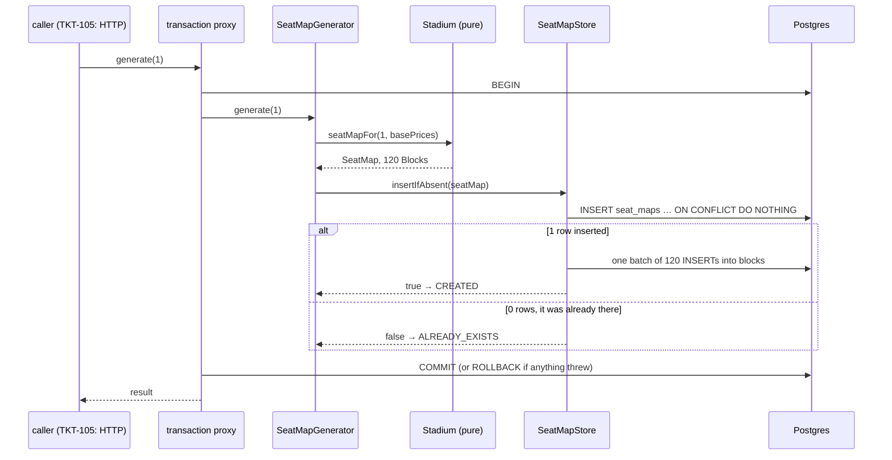

## Part 1 — The Concept

### The story: the button that gets pressed twice

Slice 1 gave you a perfect stadium in memory. Now an Admin presses **Generate Seat Map**, and it
has to end up in Postgres. That sounds like one line: save it. Four things can go wrong:

1. **The prices.** Somebody has to read them from configuration, and a missing one must stop the
   service at startup, not at the first sale.
2. **Pressed twice.** The Admin double-clicks, the browser retries after a timeout, or (from
   TKT-404) Kafka delivers `match.scheduled` **again**. The second time must change nothing.
3. **Pressed at the same moment.** Two requests on two threads, later on two pods. Each checks
   "does it exist?", each hears "no", each inserts.
4. **Stopped half-way.** The Seat Map row is in, then Block 87 fails. Now the Match *looks*
   generated but has 86 Blocks, and because it "already exists", nobody can generate it again.

This slice solves all four, and **you'll see each one fail before you fix it**.

**Done looks like:**
- [ ] The service doesn't start if a Tier has no Base Price.
- [ ] Generating stores 1 Seat Map and 120 Blocks; generating again changes nothing and says so.
- [ ] Eight Admins at the same instant: exactly one `CREATED`, seven `ALREADY_EXISTS`.
- [ ] A failure half-way leaves **nothing** behind.
- [ ] The 120 Blocks go in as **one batch**, and you noted the numbers in the PR.

### The big picture



The generator is the **application service**: it knows the order of things and no rules. The
rules are in `Stadium`, the SQL is in `SeatMapStore`.

### Ways to build it

**Storing it once:**

| Option | How it works | Where it breaks |
|---|---|---|
| Just insert | the primary key refuses the second one | the caller gets a `DuplicateKeyException` for a normal situation |
| Check, then insert | `SELECT count(*)`, insert if 0 | two threads both read 0 (you'll watch it happen) |
| `synchronized` in Java | one thread at a time | only inside **one** JVM; two pods are two JVMs |
| Catch the exception | insert, catch `DuplicateKeyException` | after an error Postgres **aborts the whole transaction**: nothing else in it can run |
| **`INSERT … ON CONFLICT DO NOTHING`** | Postgres decides, and tells you how many rows it inserted | nothing: the check and the insert are one step |

**Inserting 120 Blocks** (I measured these on Postgres 18.7, one Match):

| Option | SQL statements | Time |
|---|---|---|
| `blocks.saveAll(…)` with JPA | **242** (a `SELECT` and an `INSERT` for each of the 120 Blocks and the Seat Map) | 455–884 ms |
| `saveAll` + `Persistable` + `hibernate.jdbc.batch_size` | inserts batched, no `SELECT`s, after extra code in the entity | not measured |
| **`JdbcTemplate.batchUpdate`** | 1 for the Seat Map + **1 batch of 120** | 19–42 ms |

Times depend on the machine; the statement counts don't.

### What we chose and why

- **`ON CONFLICT DO NOTHING`**, because the database is the only place both pods share. It's the
  same idea as the overselling backstop: let the data's owner decide.
- **`batchUpdate`**, because these rows are written once, never edited and never tracked. JPA's
  strengths (dirty checking, identity, cascades) buy nothing here and cost 242 statements. In
  TKT-103-3 I said `Persistable` would fix this; the batch is simpler and does more.
- **JPA stays** for reading Blocks and for Seat Claims. Using both in one service is normal: they
  share the same connection inside a transaction (concept 2).
- **`SeatMapStore` is a plain class**, no interface (ADR-0005: one adapter, no port).

### Under the hood

#### `@ConfigurationProperties`: YAML becomes a typed object

```yaml
stadium:
  tiers:
    club-premium:
      base-price: "650.00"
```
```java
@ConfigurationProperties("stadium")
public record StadiumProperties(Map<Tier, TierProperties> tiers) {
    public record TierProperties(BigDecimal basePrice) { }
}
```

What Boot does at startup, step by step:

```text
application.yaml ─▶ Environment             "stadium.tiers.club-premium.base-price" = "650.00"
                    │
                    ▼  Binder, for prefix "stadium"
                    relaxed names           club-premium → Tier.CLUB_PREMIUM      base-price → basePrice
                    conversion              "650.00"     → BigDecimal
                    constructor             new StadiumProperties(map)
                    ▼
                    one bean, ready to inject anywhere
```

- **Why not `@Value("${…}")`?** It's one string at a time: no map, no types in one place, and
  nowhere to check that all four are there.
- **The record is checked when it's built.** A compact constructor that throws means the context
  **doesn't start**. That's *fail fast*: an error at deploy time instead of a `null` price at the
  first sale.
- **A class doesn't become a bean by having the annotation.** `@EnableConfigurationProperties`
  (or a scan) registers it.
- **⚠️ The scale trap.** YAML reads an unquoted `650.00` as a floating-point number, and the last
  zero is gone before Java sees it: you get `650.0`. The API promises `"650.00"`. Quote money.
- **Source:** [Spring Boot — Type-safe Configuration Properties](https://docs.spring.io/spring-boot/reference/features/external-config.html#features.external-config.typesafe-configuration-properties)

#### `@Transactional`: a proxy stands in front of your object

The annotation does nothing by itself. At startup Spring sees it and gives everyone else a
**proxy**, a generated subclass, instead of your object. I printed the class of the injected bean:

```text
com.stadium.inventory.application.SeatMapGenerator$$SpringCGLIB$$0
```

```text
caller ─▶ proxy.generate(1)
            BEGIN                               (takes one connection, ties it to this thread)
            └─▶ yourObject.generate(1)
                   SeatMapStore → JdbcClient  ─┐
                                 JdbcTemplate ─┴─ both use the thread's connection
            returned normally?    → COMMIT
            RuntimeException?     → ROLLBACK
            connection goes back to Hikari
```

Four facts interviewers ask about:
- **Self-invocation skips it.** `this.generate(1)` inside the same class never passes through the
  proxy, so there's no transaction.
- **Checked exceptions commit** by default. Only unchecked ones (`RuntimeException`) and `Error`s
  roll back.
- **Without it, every statement is its own transaction** (autocommit). That's how a half-built
  Seat Map gets in: the first `INSERT` is already committed when the second one fails.
- **JPA and JDBC share it.** With JPA on the classpath Boot creates a `JpaTransactionManager`,
  which also exposes its connection to JDBC code. Your Step 7 test proves it: the proxy opens a
  JPA transaction, and the JDBC inserts roll back with it.
- **Source:** [Spring Framework — Using @Transactional](https://docs.spring.io/spring-framework/reference/data-access/transaction/declarative/annotations.html), [Rolling Back](https://docs.spring.io/spring-framework/reference/data-access/transaction/declarative/rolling-back.html), [JPA transaction management](https://docs.spring.io/spring-framework/reference/data-access/orm/jpa.html)

#### A batch: 120 rows, one trip

```text
saveAll:   SELECT ─▶ ◀─  SELECT ─▶ ◀─  …  INSERT ─▶ ◀─  INSERT ─▶ ◀─        each waits for an answer
batch:     [INSERT, INSERT, INSERT, … ×120] ─────────▶ ◀─ [1, 1, 1, …]       one wait
```

The cost of an `INSERT` this small isn't Postgres working, it's **waiting for the network** 120
times. A JDBC batch prepares the statement once, collects the 120 sets of values, and sends them
together. `JdbcTemplate` hides the loop; you only say how one object fills the `?`:

```java
jdbcTemplate.batchUpdate("INSERT INTO t (a, b) VALUES (?, ?)", items, items.size(), (ps, item) -> {
    ps.setLong(1, item.a());
    ps.setString(2, item.b());
});
```

- **Why not `JdbcClient` here?** It's the newer, nicer API for one statement, which is why the
  Seat Map row uses it. It has no batch operation, so batches stay with `JdbcTemplate`.
- **Postgres arrays** need the driver: `ps.getConnection().createArrayOf("integer", values)`.
- **Source:** [Spring Framework — JDBC batch operations](https://docs.spring.io/spring-framework/reference/data-access/jdbc/advanced.html)

#### `ON CONFLICT DO NOTHING`: idempotency the database enforces

*Idempotent* means doing it twice has the same effect as doing it once. Check-then-insert can't
be, because there's a gap between the two statements:

```text
thread 1:  SELECT count → 0 ────────────────────────▶ INSERT  ✅
thread 2:         SELECT count → 0 ────────────────────────────▶ INSERT  💥 duplicate key
                                   └── the gap ──┘
```

With `ON CONFLICT (match_id) DO NOTHING` there's no gap:

```text
thread 1:  BEGIN  INSERT … ON CONFLICT → 1 row   batch of 120 …           COMMIT
thread 2:  BEGIN  INSERT … ON CONFLICT → (same key, not committed yet: WAITS) ─▶ 0 rows → ALREADY_EXISTS
```

- **The update count is the answer:** 1 = you created it, 0 = it was there.
- **The loser waits** for the winner to finish. If the winner **rolls back**, the loser inserts
  instead. So when somebody hears `ALREADY_EXISTS`, the 120 Blocks are really there. That's only
  true because both statements are in **one transaction**: the two concepts need each other.
- **Remember this pattern.** The same idea comes back with idempotency keys (TKT-503) and
  processed Kafka messages.
- **Source:** [PostgreSQL — ON CONFLICT clause](https://www.postgresql.org/docs/current/sql-insert.html#SQL-ON-CONFLICT) and [Transaction Isolation](https://www.postgresql.org/docs/current/transaction-iso.html)

---

## Part 2 — The Implementation

**The seams:**
- `StadiumProperties`, through a tiny Spring context with **no database** (`ApplicationContextRunner`).
- `SeatMapGenerator.generate(matchId)`, with a real Postgres.

| | |
|---|---|
| **They catch** | a missing or rounded price, missing Blocks, a second generation that writes, the race, a half-built Seat Map |
| **They miss** | the HTTP contract (TKT-105) and reading the Seat Map back into the domain (TKT-105 needs it first) |

How the tests move:

```text
step    test                                              red because…
──────  ────────────────────────────────────────────────  ─────────────────────────────────────────
Step 1  everyTierHasItsBasePriceFromApplicationYaml        map is {} … then 650.0 instead of 650.00
Step 2  startupFailsWhenATierHasNoBasePrice                context started successfully
Step 3  storesTheWholeStadium, twoMatchesHave…             expected: 120L but was: 0L
Step 4  (measure the batch)
Step 5  generatingAgainChangesNothing                      DuplicateKeyException, seat_maps_pkey
Step 6  whenEightAdminsGenerateAtOnce…                     DuplicateKeyException, from a thread
Step 7  aFailureHalfWayLeavesNothingBehind                 expected: 0L but was: 1L
```

### Before you start

Slice 1 is pushed and 82 tests are green. Pause **360 Active Defense**, start **Docker Desktop**.
No new dependency in this slice: the JPA starter already brought `JdbcTemplate` and `JdbcClient`.

```text
services/inventory/src/
├── main/java/com/stadium/inventory/
│   ├── application/                          ← new package
│   │   ├── StadiumProperties.java            ← new
│   │   ├── StadiumConfiguration.java         ← new
│   │   ├── GenerationResult.java             ← new (Step 3)
│   │   └── SeatMapGenerator.java             ← new (Step 3)
│   └── adapter/persistence/
│       └── SeatMapStore.java                 ← new (Step 3)
├── main/resources/application.yaml           (changed)
└── test/java/com/stadium/inventory/application/
    ├── StadiumPropertiesTest.java            ← new
    └── SeatMapGeneratorTest.java             ← new (Step 3)
```

### Step 1 — Cycle A: Base Prices from configuration

The skeleton:

```java
package com.stadium.inventory.application;

import com.stadium.inventory.domain.Tier;
import java.math.BigDecimal;
import java.util.Map;
import org.springframework.boot.context.properties.ConfigurationProperties;

@ConfigurationProperties("stadium")
public record StadiumProperties(Map<Tier, TierProperties> tiers) {

    public record TierProperties(BigDecimal basePrice) {
    }

    public Map<Tier, BigDecimal> basePrices() {
        return Map.of();
    }
}
```
```java
package com.stadium.inventory.application;

import org.springframework.boot.context.properties.EnableConfigurationProperties;
import org.springframework.context.annotation.Configuration;

@Configuration(proxyBeanMethods = false)
@EnableConfigurationProperties(StadiumProperties.class)
class StadiumConfiguration {
}
```

The test. `ApplicationContextRunner` starts a context with **only** the classes you name, so it
takes a fraction of a second. The initializer makes it read the real `application.yaml`:

```java
package com.stadium.inventory.application;

import static org.assertj.core.api.Assertions.assertThat;

import com.stadium.inventory.domain.Tier;
import java.math.BigDecimal;
import java.util.Map;
import org.junit.jupiter.api.Test;
import org.springframework.boot.test.context.ConfigDataApplicationContextInitializer;
import org.springframework.boot.test.context.runner.ApplicationContextRunner;

class StadiumPropertiesTest {

    private final ApplicationContextRunner context = new ApplicationContextRunner()
            .withUserConfiguration(StadiumConfiguration.class);

    @Test
    void everyTierHasItsBasePriceFromApplicationYaml() {
        context.withInitializer(new ConfigDataApplicationContextInitializer())
                .run(ctx -> assertThat(ctx.getBean(StadiumProperties.class).basePrices())
                        .containsOnly(
                                Map.entry(Tier.CLUB_PREMIUM, new BigDecimal("650.00")),
                                Map.entry(Tier.VIP_1, new BigDecimal("320.00")),
                                Map.entry(Tier.VIP_2, new BigDecimal("180.00")),
                                Map.entry(Tier.STANDARD, new BigDecimal("90.00"))));
    }
}
```

```bash
./mvnw -pl services/inventory test -Dtest=StadiumPropertiesTest
```

> ✅ **Expected (red):** `Tests run: 1, Failures: 1`
> ```text
> Expecting map: {} to contain only: [CLUB_PREMIUM=650.00, VIP_1=320.00, VIP_2=180.00, STANDARD=90.00]
> ```

**🟢 Green, first try.** Write `basePrices()` (yours), and add this at the **end** of
`application.yaml`, at the left margin:

```yaml
stadium:
  tiers:
    club-premium:
      base-price: 650.00
    vip-1:
      base-price: 320.00
    vip-2:
      base-price: 180.00
    standard:
      base-price: 90.00
```

> ✅ **Expected (still red, on purpose):** the scale trap from concept 1
> ```text
> Expecting map: {CLUB_PREMIUM=650.0, VIP_1=320.0, VIP_2=180.0, STANDARD=90.0}
> ```

This is the one place the test compares prices with `equals` on purpose: here the number of
decimals **is** what we check. Put quotes round the four prices (`"650.00"`).

> ✅ **Expected (green):** `Tests run: 1, Failures: 0`.

```bash
git add services/inventory/src/main/java/com/stadium/inventory/application/StadiumProperties.java
git add services/inventory/src/main/java/com/stadium/inventory/application/StadiumConfiguration.java
git add services/inventory/src/main/resources/application.yaml
git add services/inventory/src/test/java/com/stadium/inventory/application/StadiumPropertiesTest.java
git commit -m "feat(inventory): read the Base Price of every Tier from configuration"
```

### Step 2 — Cycle B: no price, no start

```java
    @Test
    void startupFailsWhenATierHasNoBasePrice() {
        context.withPropertyValues("stadium.tiers.vip-1.base-price=320.00")
                .run(ctx -> {
                    assertThat(ctx).hasFailed();
                    assertThat(ctx.getStartupFailure())
                            .hasRootCauseMessage("No Base Price for [CLUB_PREMIUM, VIP_2, STANDARD]");
                });
    }
```

No initializer this time, so `application.yaml` isn't read: only VIP_1 has a price.

> ✅ **Expected (red):** `Tests run: 2, Failures: 1`
> ```text
> … to have failed but context started successfully
> ```

**🟢 Green — yours:** a compact constructor that throws `IllegalArgumentException` with that
message.
- *Nudge:* `EnumSet.allOf(Tier.class)` minus the keys you have is the list of missing Tiers, in
  the order they're declared.
- *Nudge:* with no `stadium` section at all, `tiers` is `null`.

> ✅ **Expected (green):** `Tests run: 2, Failures: 0`. The chain Spring builds around it is
> `Failed to bind properties under 'stadium' …`, then yours as the **last** `Caused by:`.

```bash
git add services/inventory/src/main/java/com/stadium/inventory/application/StadiumProperties.java
git add services/inventory/src/test/java/com/stadium/inventory/application/StadiumPropertiesTest.java
git commit -m "feat(inventory): refuse to start without every Base Price"
```

### Step 3 — Cycle C: store the whole Stadium

```java
package com.stadium.inventory.application;

public enum GenerationResult { CREATED, ALREADY_EXISTS }
```
```java
package com.stadium.inventory.application;

import org.springframework.stereotype.Service;

@Service
public class SeatMapGenerator {

    public GenerationResult generate(long matchId) {
        return GenerationResult.CREATED;
    }
}
```

```java
package com.stadium.inventory.application;

import static org.assertj.core.api.Assertions.assertThat;

import com.stadium.inventory.TestcontainersConfiguration;
import com.stadium.inventory.adapter.persistence.BlockEntity;
import com.stadium.inventory.adapter.persistence.BlockId;
import com.stadium.inventory.adapter.persistence.repository.BlockRepository;
import com.stadium.inventory.domain.Side;
import com.stadium.inventory.domain.Tier;
import org.junit.jupiter.api.BeforeEach;
import org.junit.jupiter.api.Test;
import org.springframework.beans.factory.annotation.Autowired;
import org.springframework.boot.test.context.SpringBootTest;
import org.springframework.context.annotation.Import;
import org.springframework.jdbc.core.simple.JdbcClient;

@SpringBootTest
@Import(TestcontainersConfiguration.class)
class SeatMapGeneratorTest {

    @Autowired
    SeatMapGenerator generator;

    @Autowired
    BlockRepository blocks;

    @Autowired
    JdbcClient jdbc;

    @BeforeEach
    void emptyTables() {
        jdbc.sql("TRUNCATE seat_claims, blocks, seat_maps").update();
    }

    private long count(String table) {
        return jdbc.sql("SELECT count(*) FROM " + table).query(Long.class).single();
    }

    @Test
    void storesTheWholeStadium() {
        assertThat(generator.generate(1)).isEqualTo(GenerationResult.CREATED);

        assertThat(count("blocks")).isEqualTo(120);
        assertThat(jdbc.sql("SELECT seat_count FROM seat_maps WHERE match_id = 1")
                .query(Integer.class).single()).isEqualTo(60_560);
        BlockEntity block = blocks.findById(new BlockId(1L, "214")).orElseThrow();
        assertThat(block.getSide()).isEqualTo(Side.NORTH);
        assertThat(block.getTier()).isEqualTo(Tier.VIP_2);
        assertThat(block.getPosition()).isEqualTo((short) 13);
        assertThat(block.getRowSeats()).containsExactly(22, 22, 23, 23, 23, 23, 24, 24, 24, 24, 25, 25);
    }

    @Test
    void twoMatchesHaveTheirOwnSeatMap() {
        generator.generate(1);

        assertThat(generator.generate(2)).isEqualTo(GenerationResult.CREATED);
        assertThat(count("blocks")).isEqualTo(240);
    }
}
```

> ⚠️ **Warning — why `@SpringBootTest` and not `@DataJpaTest`.** A slice test runs each test
> **inside its own transaction** and rolls it back. That would wrap your `@Transactional` in a
> bigger one: nothing would ever commit, and neither the rollback test nor the race test could
> work. Here the code commits for real, so the test empties the tables itself with `TRUNCATE`.

```bash
./mvnw -pl services/inventory test -Dtest=SeatMapGeneratorTest
```

> ✅ **Expected (red):** `Tests run: 2, Failures: 2`: `expected: 120L but was: 0L` and
> `expected: 240L but was: 0L`.

**🟢 Green — yours,** with this starting point. No `ON CONFLICT` and no `@Transactional` yet:

```java
package com.stadium.inventory.adapter.persistence;

import com.stadium.inventory.domain.SeatMap;
import org.springframework.jdbc.core.JdbcTemplate;
import org.springframework.jdbc.core.simple.JdbcClient;
import org.springframework.stereotype.Repository;

@Repository
public class SeatMapStore {

    private static final String INSERT_SEAT_MAP = """
            INSERT INTO seat_maps (match_id, layout_version, seat_count, generated_at)
            VALUES (?, ?, ?, now())
            """;

    private static final String INSERT_BLOCK = """
            INSERT INTO blocks (match_id, block_id, level, position, side, tier, row_seats)
            VALUES (?, ?, ?, ?, ?, ?, ?)
            """;

    private final JdbcClient jdbcClient;
    private final JdbcTemplate jdbcTemplate;

    public SeatMapStore(JdbcClient jdbcClient, JdbcTemplate jdbcTemplate) {
        this.jdbcClient = jdbcClient;
        this.jdbcTemplate = jdbcTemplate;
    }

    /** True if this call stored the Seat Map, false if the Match already had one. */
    public boolean insertIfAbsent(SeatMap seatMap, String layoutVersion) {
        // 1. INSERT_SEAT_MAP with jdbcClient
        // 2. INSERT_BLOCK for all 120 Blocks, in one batch, with jdbcTemplate (concept 3)
        //    the last ? is: ps.setArray(7, ps.getConnection().createArrayOf("integer", …))
        return true;
    }
}
```

`SeatMapGenerator` gets the store and `StadiumProperties` in its constructor, and its `generate`
is the three arrows of the sequence diagram: build, store, translate the boolean.

- *Nudge:* an enum goes into a `VARCHAR` as its `name()`.
- *Nudge:* the Base Price is **not** stored: it has no column on purpose (DATA-MODEL §2).

> ✅ **Expected (green):** `Tests run: 2, Failures: 0`.

```bash
git add services/inventory/src/main/java/com/stadium/inventory/application/GenerationResult.java
git add services/inventory/src/main/java/com/stadium/inventory/application/SeatMapGenerator.java
git add services/inventory/src/main/java/com/stadium/inventory/adapter/persistence/SeatMapStore.java
git add services/inventory/src/test/java/com/stadium/inventory/application/SeatMapGeneratorTest.java
git commit -m "feat(inventory): store the Seat Map of a Match"
```

### Step 4 — See the batch

> ⚠️ **Warning — PowerShell and dots.** PowerShell splits an unquoted `-Dlogging.level…` at the
> dots. Keep the quotes round the whole argument.

```powershell
./mvnw -pl services/inventory test "-Dtest=SeatMapGeneratorTest" "-Dlogging.level.org.springframework.jdbc.core.JdbcTemplate=debug"
```

> ✅ **Expected:** one line per generation, not 120:
> ```text
> … JdbcTemplate : Executing SQL batch update [INSERT INTO blocks …] with a batch size of 120
> ```

Write the number in the PR description, next to the 242 statements that `saveAll` needs.

### Step 5 — Cycle D: generating again changes nothing

Add to the test class (import `java.time.OffsetDateTime`):

```java
    @Test
    void generatingAgainChangesNothing() {
        generator.generate(1);
        OffsetDateTime before = generatedAt();

        assertThat(generator.generate(1)).isEqualTo(GenerationResult.ALREADY_EXISTS);

        assertThat(count("blocks")).isEqualTo(120);
        assertThat(generatedAt()).isEqualTo(before);
    }

    private OffsetDateTime generatedAt() {
        return jdbc.sql("SELECT generated_at FROM seat_maps WHERE match_id = 1")
                .query(OffsetDateTime.class).single();
    }
```

`generated_at` is the witness: if the second call rewrote anything, the time would move.

> ✅ **Expected (red):** `Tests run: 3, Errors: 1`. An error, and the right one:
> ```text
> DuplicateKeyException … duplicate key value violates unique constraint "seat_maps_pkey"
>   Detail: Key (match_id)=(1) already exists.
> ```

**🟢 Green, the obvious way first — yours:** in `insertIfAbsent`, count the Seat Maps of this Match
and return `false` if there's one.

> ✅ **Expected (green):** `Tests run: 3, Failures: 0`. It looks finished. **Don't commit**: the next
> test shows why.

### Step 6 — Cycle E: eight Admins, one instant

```java
    @Test
    void whenEightAdminsGenerateAtOnceExactlyOneCreatesIt() throws Exception {
        int admins = 8;
        CountDownLatch start = new CountDownLatch(1);
        List<Future<GenerationResult>> answers = new ArrayList<>();
        try (ExecutorService pool = Executors.newFixedThreadPool(admins)) {
            for (int i = 0; i < admins; i++) {
                answers.add(pool.submit(() -> {
                    start.await();               // everyone waits at the gate
                    return generator.generate(1);
                }));
            }
            start.countDown();                   // the gate opens once, for all
        }

        List<GenerationResult> results = new ArrayList<>();
        for (Future<GenerationResult> answer : answers) {
            results.add(answer.get());
        }
        assertThat(results).containsOnlyOnce(GenerationResult.CREATED);
        assertThat(count("blocks")).isEqualTo(120);
    }
```

Imports: `java.util.ArrayList`, `java.util.List`, `java.util.concurrent.CountDownLatch`,
`ExecutorService`, `Executors`, `Future`.

```text
            ┌─ thread 1 ─┐
latch(1) ───┤  … 8 …     ├── countDown() ──▶ all call generate(1) together
            └─ thread 8 ─┘
```

Without the gate, thread 1 would finish before thread 8 is even created, and the test would pass
for the wrong reason.

> ✅ **Expected (red):** `Tests run: 4, Errors: 1`
> ```text
> ExecutionException: DuplicateKeyException … unique constraint "seat_maps_pkey"
> ```
> A race isn't guaranteed to show on every run. I ran it four times and got this red four times;
> if yours is green once, run it again.

**🟢 Green — yours:** throw the check away. Add `ON CONFLICT (match_id) DO NOTHING` to
`INSERT_SEAT_MAP` and let the **update count** decide.

> ✅ **Expected (green):** `Tests run: 4, Failures: 0`, and less code than before.

```bash
git add services/inventory/src/main/java/com/stadium/inventory/adapter/persistence/SeatMapStore.java
git add services/inventory/src/test/java/com/stadium/inventory/application/SeatMapGeneratorTest.java
git commit -m "feat(inventory): generate a Seat Map only once per Match"
```

### Step 7 — Cycle F: all or nothing

How do you make the insert fail half-way? Give Postgres a temporary rule that refuses the Upper
Level. The Lower and Club Blocks are fine, then Block 301 isn't:

```java
    @Test
    void aFailureHalfWayLeavesNothingBehind() {
        jdbc.sql("ALTER TABLE blocks ADD CONSTRAINT test_no_upper CHECK (level <> 'UPPER')").update();
        try {
            assertThatThrownBy(() -> generator.generate(1))
                    .isInstanceOf(DataIntegrityViolationException.class)
                    .hasMessageContaining("test_no_upper");
        } finally {
            jdbc.sql("ALTER TABLE blocks DROP CONSTRAINT test_no_upper").update();
        }

        assertThat(count("seat_maps")).isZero();
        assertThat(count("blocks")).isZero();
    }
```

Imports: `assertThatThrownBy`, `org.springframework.dao.DataIntegrityViolationException`.

> ✅ **Expected (red):** `Tests run: 5, Failures: 1`
> ```text
> expected: 0L
>  but was: 1L
> ```
> That `1` is the disaster from the story: a Seat Map without its Blocks, which can **never be
> generated again**, because it "already exists".

**🟢 Green — yours:** one annotation, on `SeatMapGenerator.generate`
(`org.springframework.transaction.annotation.Transactional`).

> ⚠️ **Warning — import the Spring one.** IntelliJ also offers `jakarta.transaction.Transactional`.
> Spring understands that one too, but it has different options (no `readOnly`, other rollback
> settings). We use Spring's everywhere.

> ✅ **Expected (green):** `Tests run: 5, Failures: 0`.

See the proxy at work (quotes again):

```powershell
./mvnw -pl services/inventory test "-Dtest=SeatMapGeneratorTest" "-Dlogging.level.org.springframework.transaction.interceptor=trace"
```

> ✅ **Expected:** `Getting transaction for [com.stadium.inventory.application.SeatMapGenerator.generate]`,
> then `Completing transaction for […]`.

```bash
git add services/inventory/src/main/java/com/stadium/inventory/application/SeatMapGenerator.java
git add services/inventory/src/test/java/com/stadium/inventory/application/SeatMapGeneratorTest.java
git commit -m "feat(inventory): store a Seat Map completely or not at all"
```

### Step 8 — Everything together

```bash
./mvnw -pl services/inventory test
```

> ✅ **Expected:** `Tests run: 89, Failures: 0, Errors: 0` (82 + 2 + 5).

Then start the real app with one price commented out, to see fail-fast where it matters:

```bash
docker compose up -d
./mvnw -pl services/inventory spring-boot:run
```

> ✅ **Expected:** with the two `standard` lines removed from the YAML, the app doesn't start, and
> Boot explains it in plain words:
> ```text
> APPLICATION FAILED TO START
> Failed to bind properties under 'stadium' to com.stadium.inventory.application.StadiumProperties:
>     Reason: java.lang.IllegalArgumentException: No Base Price for [STANDARD]
> ```
> Put them back and it starts. There's nothing to call yet: the HTTP endpoint is TKT-105.

```bash
git push
```

**The ticket is built.** Run `/code-review`, make the refactor commits, then fill in the PR:
each acceptance criterion with its proof, the batch size, and the 242. Then **`gh pr ready`, and
tell me before you merge** (record 0004): I review, write the close step, and say "merge".

#### If it goes wrong

| What you see | Where | What it means |
|---|---|---|
| `No qualifying bean of type 'StadiumProperties'` | any context | `@EnableConfigurationProperties` is missing, or its class is outside `com.stadium.inventory` |
| `No Base Price for [CLUB_PREMIUM, VIP_1, VIP_2, STANDARD]` in **every** test | startup | the `stadium:` section is indented under another key in `application.yaml` |
| `column "row_seats" is of type integer[] but expression is of type …` | Step 3 | the array wasn't made with `createArrayOf("integer", …)` |
| `violates foreign key constraint "blocks_match_id_fkey"` | Step 3 | the Blocks were sent before the Seat Map row |
| `current transaction is aborted` | Steps 5–7 | an error was caught and more SQL followed in the same transaction |
| the rollback test stays red with `@Transactional` in place | Step 7 | the method is called through `this`, is `private` or `final`, or the annotation is on another method |
| the race test hangs | Step 6 | `countDown()` is inside the loop or after the `try` block closed |
| `Could not connect to Ryuk` | tests | 360 Active Defense again |

---

## Check yourself

```quiz
Eight threads call check-then-insert. Why can two of them insert?
- [x] Both can read zero before either one has inserted
- [ ] The primary key is only checked when the app ends
- [ ] HikariCP runs the same statement on two connections
> The check and the insert are two steps with a gap between them; ON CONFLICT makes them one step inside Postgres.
```

```quiz
What tells the generator that the Seat Map already existed?
- [ ] A DuplicateKeyException caught inside the service
- [ ] A second SELECT that runs right after the INSERT
- [x] An update count of zero from ON CONFLICT DO NOTHING
> One row inserted means this call created it; zero rows means it was already there.
```

```quiz
Why does this.generate(1) inside the same class run without a transaction?
- [ ] Transactions only work for calls that come over HTTP
- [x] The call does not pass through the proxy Spring made
- [ ] Spring allows a single transaction for every class
> @Transactional works in the proxy around the bean; a call on `this` goes straight to the target object.
```

```quiz
Why is saveAll slower than batchUpdate for these 120 Blocks?
- [x] It sends 242 statements, and waits after each of them
- [ ] It locks the whole table until the last Block is in
- [ ] It converts every Row into JSON before it is stored
> With assigned ids, save() means a SELECT then an INSERT per entity. The batch sends all 120 inserts together.
```

```quiz
Why are the prices quoted in application.yaml?
- [ ] Because Spring can only bind text values to a record
- [ ] Because enum keys need quotes to be found in a map
- [x] Because an unquoted 650.00 reaches Java as 650.0
> YAML reads an unquoted 650.00 as a floating-point number, so the scale is lost before BigDecimal is created.
```

---

_Ask me anything that's unclear — about the lesson, the docs, or what you see in your terminal._
